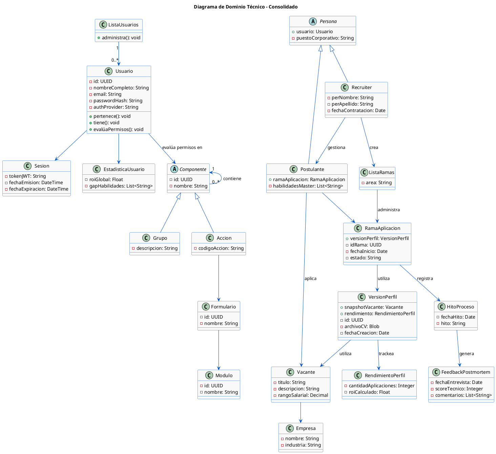

# JobBranch — Project Specification

> **Status:** Draft v1.0 · Derived from academic deliverable (Parcial N2, Ingeniería de Software, UAI — Jul 2026)
> **Owner:** Octavio Cossy Torquati (`ovct`)

---

## 1. Overview

JobBranch is a platform that turns the job search into a product-management process. It centralizes traceability of job applications through a **branch architecture**: each selection process is a "branch" linked to a specific CV version, a company, and a vacancy. The candidate manages their career with the same rigor as a software pipeline.

**Core value propositions:**

- Know exactly which CV version was sent to which company.
- Visualize every process as a branch moving through defined milestones.
- Learn from rejections via structured post-mortem feedback.
- Fight recruiter "ghosting" with automated follow-up alerts.
- Improve over time with data: skill-gap analysis and per-CV-version ROI.

## 2. Goals & Non-Goals

### Goals

1. Document versioning (CV / cover letters) linked to each application.
2. Visual dashboard of application "branches" and milestones.
3. Performance metrics: skill gap analysis and profile ROI.
4. Anti-ghosting follow-up alert system.

### Non-Goals (explicit exclusions)

- Direct communication with recruiters from the platform.
- Automated applications to external portals (scraping/bots).
- Automatic synchronization with personal email inboxes.

## 3. Users & Roles

| Role | Description | Key expectations |
|---|---|---|
| **Postulante** (Candidate) | Primary end user | Centralize processes, manage CV versions, get improvement metrics |
| **Recruiter** | Secondary user | Access vacancy boards and searches, manage branches/candidates |
| **Administrador** | System role | Manage users and the permission matrix |
| **Sistema (Core)** | Internal actor | Builds permission trees at session init |

Role is selected at registration and **cannot be changed by the user afterwards** (see BR-3).

## 4. Functional Requirements

### 4.1 Module: Profile Repository & Versioning

- **RF01 — Repository Management:** Upload and version files (CVs and cover letters), associating them with a specific profile version.
- **RF16 — Versioned Profile Repository:** A Postulante can create multiple labeled career profiles (e.g. `v1.0 Fullstack`, `v2.0 Frontend Focused`), attach physical files (PDF/DOCX), track application history per version, and select exactly one version as the default **"Perfil de Salida"** (Output Profile) used when applying to vacancies.

### 4.2 Module: Branch Management (Processes)

- **RF02 — Application Traceability:** Create one "branch" per selection process, linking a company and a vacancy.
- **RF03 — State Management:** Change application states (Enviado, Entrevista, Oferta, Rechazo, etc.).
- **RF07 — Clone Application:** Clone a previous application's data (company, requirements, profile used) for similar vacancies.
- **RF08 — Milestone Timeline:** Chronological history of state changes per branch, showing time spent in each stage.
- **RF09 — Branch Archiving:** Archive finished processes (Rejected/Offer) to clean the active dashboard without losing history.

### 4.3 Module: Analytics & Intelligence

- **RF06 — Analytics Dashboard:** Conversion-rate reports and skill-gap analysis.
- **RF10 — Technology Heatmap:** Heatmap of vacancy keywords where the user was rejected vs. advanced.
- **RF11 — Profile ROI:** Success index per CV version: `interviews obtained / total applications`.

### 4.4 Module: Follow-up (Anti-Ghosting)

- **RF05 — Alert System:** Trigger follow-up notifications based on recruiter inactivity days.
- **RF12 — Contact Registry:** Store recruiter contact data (name, LinkedIn, email) per branch.
- **RF13 — Reminder Automation:** Auto-generate a follow-up task if an application doesn't change state in 7 or 15 days (configurable).

### 4.5 Module: Feedback

- **RF04 — Feedback Registry (Post-Mortem):** Load qualitative data after each interaction: interview date/type, technical score, culture score, comments, missing skills.

### 4.6 Module: Core — Auth, Security & Infrastructure

- **RF14 — Cryptographic Authentication:** Secure native registration/login (BCrypt + salt) or federated OAuth (GitHub/Google), issuing signed JWTs. Role (Postulante/Recruiter) is chosen explicitly at registration.
- **RF15 — Permission Matrix (Composite Pattern):** Hierarchical, dynamic evaluation of board/repository access using the Composite pattern (`ComponentePermiso` → `GrupoPermisos` composite nodes / `Accion` leaf nodes), blocking unauthorized actions per instantiated role.

## 5. Business Rules

| ID | Rule |
|---|---|
| BR-1 | Native passwords are hashed with BCrypt + salt before persistence. |
| BR-2 | Email is unique across the whole system. |
| BR-3 | The role selected at registration cannot be altered directly by a regular user. |
| BR-4 | Every authenticated user must be associated with at least one `GrupoPermisos` (composite node) or one `Accion` (leaf node) to interact with boards/repositories. |
| BR-5 | A user can have at most **one** profile version marked as Output Profile / BEST at a time. |
| BR-6 | Max attachment size: **10 MB** per document (PDF/DOCX). |
| BR-7 | New profile versions inherit the base profile's tags unless explicitly modified. |
| BR-8 | Profiles with active applications in the pipeline cannot be deleted — only archived. |
| BR-9 | A profile without an attached file cannot be activated (Draft → Active requires file upload). |
| BR-10 | An archived profile cannot be used for new applications, but retains its ROI history. |
| BR-11 | Failed logins increment a counter; error messages are generic ("Email o contraseña incorrectos"). |
| BR-12 | If OAuth provider fails or returns an invalid token, the operation is cancelled and the user is prompted to use native login. |

## 6. Domain Model

### 6.1 Core entities

- **Usuario** — `id: UUID`, `nombreCompleto`, `email (unique)`, `passwordHash`, `authProvider`, `intentosFallidos`. Starts a `Sesion`.
- **Sesion** — `tokenJWT`, `fechaEmision`, `fechaExpiracion`. Initializes the `ContextoSeguridad`.
- **Persona** (abstract) — has a `usuario: Usuario` attribute (composition, **not** inheritance — per professor feedback), `resolverPermisos(): ComponentePermiso`. Specialized by:
  - **Postulante** — `habilidadesMaster: List<String>`; owns 0..* `VersionPerfil`; applies to `Vacante` via `RamaAplicacion`.
  - **Recruiter** — `areaEmpresa`, `puestoCorporativo`; creates/manages `ListaRamas`.
- **ComponentePermiso** (abstract, Composite pattern) — `evaluar(): Boolean`, `agregarHijo()`, `obtenerHijos()`.
  - **GrupoPermisos** (composite) — contains children.
  - **Accion** (leaf) — `codigoAccion`; executes on a `Formulario`, which belongs to a `Modulo`.
- **ContextoSeguridad** — `cargarMatriz(componente)`, `tienePermiso(codigoAccion): Boolean`.

### 6.2 Pipeline entities

- **VersionPerfil** — `id: UUID`, `archivoCV: Blob`, `tamanioBytes`, `tags: List<String>`, `esPerfilSalida: Boolean`, `estado`, `fechaCreacion`; self-relation `deriva de (0..1)`; tracked by `RendimientoPerfil`. The `VersionPerfil` reference lives on `RamaAplicacion` (per professor feedback — the branch snapshots which version was used).
- **RamaAplicacion** — `idRama: UUID`, `fechaInicio`, `estadoActual`, `esActiva`, `calcularAlertaGhosting(): Boolean`; links `VersionPerfil` + `Vacante`; registers 1..* `HitoProceso`.
- **Vacante** — `titulo`, `descripcion`, `tecnologiasRequeridas: List<String>`, `rangoSalarial`; belongs to an **Empresa** (`nombre`, `industria`, `sitioWeb`, `reputacionTimeResponse`).
- **HitoProceso** — `fechaHito`, `tipo`, `fechaRecordatorioFollowUp`, `observaciones`; generates `FeedbackPostMortem` (0..1) and `Recordatorio` (0..*).
- **FeedbackPostMortem** — `fechaEntrevista`, `tipoEntrevista`, `scoreTecnico`, `scoreCultura`, `comentariosCualitativos`, `habilidadesFaltantes: List<String>`.
- **Recordatorio** — `fechaVencimiento`, `diasInactividad`, `estado`, `verificarVencimiento(): Boolean`, `notificar()`.
- **RendimientoPerfil** — `cantidadAplicaciones`, `roiCalculado: Float`.
- **EstadisticaUsuario** — `roiGlobal`, `gapHabilidades`, `recalcularRoi()`, `detectarGaps()`.

### 6.3 Technical Domain Diagram (PlantUML)

Consolidated technical domain model. Note the corrected relationships per professor feedback: `Persona` **composes** `Usuario` (attribute, not inheritance) and `RamaAplicacion` holds the `VersionPerfil` reference.



## 7. State Machines

### 7.1 Profile Version (CV) lifecycle

```
[*] → Borrador → (upload PDF/DOCX + save) → Activo
Activo := { Disponible ⇄ Seleccionado_Como_Salida }
Activo → (archive outdated/deprecated version) → Archivado
Archivado → (unarchive) → Disponible
```

- `Disponible → Seleccionado_Como_Salida`: "Establecer como Activo Principal" (demotes any current one — BR-5).
- Guard: cannot activate from Borrador without an attached file (BR-9).
- Archivado cannot be used for new applications (BR-10).

### 7.2 Application (branch) lifecycle

`Enviado → Entrevista Técnica → RRHH → Oferta | Rechazo` — each transition recorded as a `HitoProceso`; terminal states allow archiving (RF09).

## 8. Architecture

**Layered architecture** (per sequence diagrams): `IU_* (boundary) → *Controller → *Service → Entities / DAOs`.

- **Auth flow (CU14):** `IU_Login → AuthController.autenticar() → AuthService.validarCredenciales() → Usuario.verificarHashBCrypt() → generarTokenJWT(claims) → new Sesion(tokenJWT)` → redirect to dashboard.
- **Permission flow (CU15):** on session init, `SecurityController.construirMatriz(usuario)` → `PermisoService` obtains role, builds the Composite root, `evaluar()` traverses the tree → `new ContextoSeguridad(matrizPermisos)` injected into the session.
- **Profile flow (CU16):** `IU_RepositorioPerfiles → PerfilController → PerfilService` — list versions + metrics, `registrarVersion(datos, archivo, tags)`, `marcarPerfilSalida(idVersion)` → `actualizarVisibilidadVacantes()`.
- **Data access:** Repository/DAO layer with one DAO per aggregate (`UsuarioDAO`, `PersonaDAO`, `ComponentePermisoDAO`, `RamaAplicacionDAO`, `VersionPerfilDAO`, `VacanteDAO`, `HitoProcesoDAO`, `RecordatorioDAO`).
- **Persistence:** relational model with explicit PKs/FKs and cardinalities (tables mirror the entities above, plus join/hierarchy tables for the permission composite: `PermisosJerarquia`, `PersonaPermisos`).

## 9. Non-Functional Requirements & Acceptance Criteria

| Category | Requirement |
|---|---|
| Capacity | ≥ 5 CV versions per user (upload + association) |
| Performance | Metric reports generated in < 3 seconds |
| UX | Branch progress shown graphically without ambiguity |
| Platform | Web-responsive (mobile access) |
| Privacy | Feedback data and CVs encrypted; GDPR compliance |
| Security | BCrypt+salt hashing, signed JWTs, generic auth error messages, failed-attempt counter |

**Assumptions:** users have their CVs in PDF/DOCX; users are willing to load interview feedback manually.

## 10. Iteration Plan

### Iteration 1 — Core & Security (current)

Foundation layer everything else builds on:

1. Registration/login (native + OAuth GitHub/Google), JWT sessions.
2. Differentiated profiles (Postulante / Recruiter) with role selection at signup.
3. Permission matrix via Composite pattern (ComponentePermiso / GrupoPermisos / Accion).
4. Profile repository: upload CV (≤ 10 MB), write cover letters, manage versioning, set Output Profile.

**Key processes:** identity & role establishment (drives the dynamic permission tree) and Output Profile preparation/versioning (tags + file packaging define which career "release" is live).

### Future iterations (from master requirements)

- Branch pipeline: create/clone branches, state management, milestone timeline, archiving (RF02, RF03, RF07–RF09).
- Anti-ghosting: contacts, reminders, inactivity alerts (RF05, RF12, RF13).
- Feedback & analytics: post-mortem module, heatmap, ROI, conversion dashboard (RF04, RF06, RF10, RF11).

## 11. Open Questions

- Tech stack is not fixed by the source document (only "web-responsive"). Candidate stack given prior work: TypeScript/React/Next.js + PostgreSQL, or .NET backend.
    - Use the current stack in the project.
- Storage strategy for CV blobs (DB `Blob` per model vs. object storage + reference) — the domain model says `archivoCV: Blob`, revisit for production.
- Notification channel for reminders (in-app only vs. email/push).
    - Out of scope
- Recruiter-side scope: the model includes Recruiter managing branches and vacancies, but the product narrative is candidate-centric — clarify how much recruiter functionality ships in v1.

---

*Traceability: RF numbering, use cases (CU14–CU16), business rules, and diagrams map 1:1 to the academic document "Evaluación Parcial 2 — JobBranch" (v3.0, 04/07/2026), including professor feedback from Devolución Parcial Nro. 1 (Persona composes Usuario instead of inheriting; VersionPerfil referenced from RamaAplicacion).*