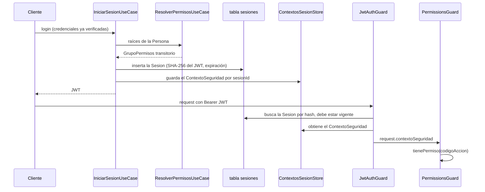

# Alineación del módulo de seguridad (épica #25): qué se construyó y qué patrones usa

Cómo se alineó el módulo de seguridad con la especificación académica (UAI *Trabajo de Diploma*,
v8.0), con el código real detrás de cada punto.

- **Fuente:** commit `126131e`, la cabeza de `epic/25-security-module-alignment` (PR #34 hacia `main`).
- **Extractos:** cada fragmento de código de abajo está copiado de ese commit por rango de líneas, con
  su ruta y números de línea encima, de modo que cualquier referencia a una línea se pueda comprobar.
- **Nombres:** los identificadores del ámbito de seguridad usan literalmente los nombres en español de
  la especificación (`Usuario`, `ComponentePermiso`, `Sesion`, `ContextoSeguridad`, …) según el
  ADR-0023. Los comentarios del código están en inglés.
- **Términos e invariantes:** los invariantes numerados que se citan aquí (2, 3, 10–14) viven en
  `.agents/ubiquitous-language-invariants.md`; el vocabulario vive en `.agents/ubiquitous-language.md`.

## 1. Qué entregó la épica

Ocho issues hijos, cada uno implementado por un agente headless, revisado por una revisión agéntica y
aprobado por una persona antes de que el runner lo integrara en la rama de la épica.

| Hijo | Porción |
|------|---------|
| #26 | Identidad de `Usuario`: `autenticar`, `incrementarIntentos`, `obtenerRol` y el puerto de catálogo `ListaUsuarios` |
| #27 | La matriz de permisos persistida como árbol, una factory de raíces por defecto por rol y el rol `Administrador` (4 rondas de rework) |
| #28 | `Sesion`: una sesión de login persistida, que debe estar vigente en cada request autenticado, más el logout |
| #29 | Ocho endpoints del Administrador que gestionan la matriz (CU-15) y un `GET /security/matrix` agrupado |
| #30 | Web consciente de los permisos: el sidebar, las rutas y los botones siguen los permisos de quien llama |
| #31 | Una `Accion` por endpoint protegido y un test de auditoría que lo hace cumplir |
| #32 | La pantalla de administración de la matriz |
| #33 | Actualización de la documentación y del runbook |

## 2. Los patrones de un vistazo

| Patrón | Dónde | Qué hace aquí |
|--------|-------|---------------|
| **Composite** (obligatorio en la especificación) | `ComponentePermiso`, `GrupoPermisos`, `Accion` | Un único árbol de permisos; un grupo concede lo que conceda cualquiera de sus hijos, una hoja concede un solo código |
| **Abstract Factory** (obligatorio en la especificación) | `MatrizPermisosFactory` y tres factories por rol | Define las raíces por defecto de cada rol y las siembra y entrega |
| **Arquitectura de casos de uso (hexagonal)** | `modules/*/{domain,application,infrastructure,presentation}` | El dominio y los puertos no saben nada de Nest ni de Drizzle; los casos de uso orquestan |
| **Repository / Catálogo** | `ListaUsuarios`, `SesionRepository`, `ComponentePermisoRepository` | La persistencia detrás de interfaces; los usuarios se consultan a través del catálogo |
| **Guard + decorador de metadatos** | `@RequiereAccion`, `JwtAuthGuard`, `PermissionsGuard` | Cada endpoint declara su Accion; el guard la verifica |
| **Objeto de contexto + almacén en memoria** | `ContextoSeguridad`, `ContextosSesionStore` | Los permisos de una Sesion se resuelven una sola vez, al iniciar sesión |
| **Escrituras transaccionales** | `reemplazarHijos`, `eliminarGrupo` | Un cambio de la matriz que toca varias filas se confirma o se revierte como una unidad |
| **Errores de dominio mapeados en el borde** | `aHttp` en el controlador de administración | Los casos de uso lanzan errores de dominio; el controlador los mapea a 404 / 400 / 409 |
| **Test de auditoría de arquitectura** | `endpoint-permissions.audit.spec.ts` | Rompe el build cuando un endpoint no tiene Accion |
| **Servicio → hooks de consulta → vistas con permisos** (web) | `security_service`, `usePermissions`, `RoutePermissionGuard` | El estado del servidor vive en hooks; la UI oculta lo que quien llama no puede hacer |

## 3. Composite: el árbol de permisos

La especificación modela los permisos como un árbol. `ComponentePermiso` es el componente abstracto.
Su hoja y su compuesto sobrescriben `evaluar`, y la hoja rechaza hijos.

`apps/api/src/modules/security/domain/componente-permiso.ts` · líneas 1–19

```ts
/** SPEC 19.13 Composite component. Nodes are shared: at most one parent (`contiene`), yet any number of Personas may hold a node as a root (invariant 12). */
export abstract class ComponentePermiso {
  constructor(
    public readonly id: string,
    public readonly nombre: string,
  ) {}

  abstract evaluar(codigoAccion: string): boolean;

  abstract obtenerHijos(): ComponentePermiso[];

  agregar(_hijo: ComponentePermiso): void {
    throw new Error(`${this.nombre} no admite hijos`);
  }

  remover(_hijo: ComponentePermiso): void {
    throw new Error(`${this.nombre} no admite hijos`);
  }
}
```

`GrupoPermisos` es el compuesto. `evaluar` es el OR de sus hijos, mediante un recorrido recursivo:

`apps/api/src/modules/security/domain/grupo-permisos.ts` · líneas 3–34

```ts
/** SPEC 19.13 composite: the only interior node of a tree; `evaluar` is the OR of its children. */
export class GrupoPermisos extends ComponentePermiso {
  private readonly hijos: ComponentePermiso[] = [];

  constructor(
    id: string,
    nombre: string,
    public readonly descripcion: string | null = null,
  ) {
    super(id, nombre);
  }

  evaluar(codigoAccion: string): boolean {
    return this.hijos.some((hijo) => hijo.evaluar(codigoAccion));
  }

  obtenerHijos(): ComponentePermiso[] {
    return this.hijos;
  }

  agregar(hijo: ComponentePermiso): void {
    this.hijos.push(hijo);
  }

  remover(hijo: ComponentePermiso): void {
    const index = this.hijos.findIndex((actual) => actual.id === hijo.id);

    if (index >= 0) {
      this.hijos.splice(index, 1);
    }
  }
}
```

`Accion` es la hoja. Coincide exactamente con su propio código y no tiene hijos:

`apps/api/src/modules/security/domain/accion.ts` · líneas 3–21

```ts
/** SPEC 19.13 leaf: one permitted action, identified by `codigoAccion` and executed in one Formulario. */
export class Accion extends ComponentePermiso {
  constructor(
    id: string,
    nombre: string,
    public readonly codigoAccion: string,
    public readonly formularioId: string,
  ) {
    super(id, nombre);
  }

  evaluar(codigoAccion: string): boolean {
    return codigoAccion === this.codigoAccion;
  }

  obtenerHijos(): ComponentePermiso[] {
    return [];
  }
}
```

`ContextoSeguridad` guarda el árbol de la Persona de una Sesion y responde por ella. `tienePermiso`
es una única delegación a la raíz, que es justamente el sentido del patrón:

`apps/api/src/modules/security/domain/contexto-seguridad.ts` · líneas 4–31

```ts
export class ContextoSeguridad {
  private root: ComponentePermiso;

  constructor(root: ComponentePermiso) {
    this.root = root;
  }

  cargarMatriz(componente: ComponentePermiso): void {
    this.root = componente;
  }

  tienePermiso(codigoAccion: string): boolean {
    return this.root.evaluar(codigoAccion);
  }

  /** Every permitted `codigoAccion` once, even when a group is reachable through several roots. */
  listarAcciones(): string[] {
    return [...new Set(this.flatten(this.root))];
  }

  private flatten(componente: ComponentePermiso): string[] {
    if (componente instanceof Accion) {
      return [componente.codigoAccion];
    }

    return componente.obtenerHijos().flatMap((hijo) => this.flatten(hijo));
  }
}
```

**Una Persona tiene una o más raíces** (invariante 12), pero el `resolverPermisos()` de la
especificación devuelve un único componente. El caso de uso concilia ambas cosas envolviendo las
raíces en un grupo transitorio que nunca se persiste:

`apps/api/src/modules/security/application/use-cases/resolver-permisos.use-case.ts` · líneas 19–43

```ts
  /**
   * Returns a transient, never-persisted GrupoPermisos over the Persona's roots, so 19.13's single-component
   * `resolverPermisos(): ComponentePermiso` and `cargarMatriz(componente)` stay literal while a Persona holds 1..* roots.
   * Without a Persona the group is empty, which denies everything.
   */
  async execute(usuarioId: string): Promise<ComponentePermiso> {
    this.logger.debug(`Resolving permission tree for usuarioId=${usuarioId}`);

    const persona = await this.personaRepository.findByUsuarioId(usuarioId);

    if (!persona) {
      this.logger.warn(`Usuario without Persona, every permission denied usuarioId=${usuarioId}`);

      return new GrupoPermisos(`usuario:${usuarioId}`, "Sin Persona");
    }

    const raices = await this.componenteRepository.findArbolByPersona(persona.id);
    const arbol = new GrupoPermisos(`persona:${persona.id}`, "Raíces de la Persona");

    for (const raiz of raices) {
      arbol.agregar(raiz);
    }

    return arbol;
  }
```

Los nodos son compartidos: un nodo tiene como máximo un padre, y aun así cualquier cantidad de
Personas puede tenerlo como raíz. Por eso el valor por defecto de un rol es un *conjunto* de grupos
raíz compartidos y no un grupo por rol.

## 4. Abstract Factory: raíces por defecto por rol

El catálogo del seed son datos puros. Cada grupo y cada Accion se describe con un id permanente:

`apps/api/src/modules/security/domain/catalogo-matriz.ts` · líneas 18–33

```ts
export interface GrupoDefinicion {
  id: string;
  nombre: string;
  descripcion: string;
  padreId: string | null;
}

export interface AccionDefinicion {
  codigoAccion: string;
  nombre: string;
  formularioId: string;
  /** Id of the default group the Accion is first seeded under; a later move by an Administrador survives a re-sync. */
  grupoPorDefecto: string;
  /** The use cases the Accion traces to. */
  cu: readonly CasoDeUso[];
}
```

La interfaz de la factory es el Abstract Factory. Una factory de rol *define* sus raíces por defecto
y *siembra* los grupos compartidos; nunca construye el árbol en tiempo de ejecución que usa una
Sesion (ese se carga desde la base de datos):

`apps/api/src/modules/security/application/factories/matriz-permisos.factory.ts` · líneas 10–25

```ts
/**
 * Abstract Factory, one per role: defines the role's default roots, seeds their shared groups and hands them to a Persona.
 * A new Persona is created holding `raicesPorDefecto()` in one transaction (invariant 12); `otorgarRaices` is the
 * reconcile path for a Persona found holding none.
 */
export interface MatrizPermisosFactory {
  readonly tipo: PersonaTipo;
  /** The role's default roots: ids of shared default groups. */
  raicesPorDefecto(): readonly string[];
  /** In-memory build of the role's default trees (documents and tests the role's grants; never persisted from here). */
  crear(): ComponentePermiso[];
  /** Seeds this role's shared default groups (and their subgroups) when missing. */
  sembrar(): Promise<void>;
  /** Hands an existing Persona this role's default roots; ignores the ones it already holds. */
  otorgarRaices(personaId: string): Promise<void>;
}
```

La clase base implementa una sola vez la mecánica compartida. `crear()` arma un árbol en memoria a
partir del catálogo, `sembrar()` escribe los grupos y `otorgarRaices()` se los entrega a una Persona:

`apps/api/src/modules/security/application/factories/matriz-permisos.factory.ts` · líneas 29–64

```ts
/** Plain classes, not `@Injectable`, so the seed script can build them too. */
abstract class MatrizPermisosFactoryBase implements MatrizPermisosFactory {
  abstract readonly tipo: PersonaTipo;

  constructor(private readonly repository: ComponentePermisoRepository) {}

  abstract raicesPorDefecto(): readonly string[];

  crear(): ComponentePermiso[] {
    return this.raicesPorDefecto().map((id) => this.construirGrupo(grupoPorId(id)));
  }

  async sembrar(): Promise<void> {
    const grupos = this.raicesPorDefecto().flatMap((id) => conDescendientes(grupoPorId(id)));

    await this.repository.asegurarGrupos(grupos);
  }

  async otorgarRaices(personaId: string): Promise<void> {
    await this.repository.asignarRaices(personaId, this.raicesPorDefecto());
  }

  private construirGrupo(definicion: GrupoDefinicion): GrupoPermisos {
    const grupo = new GrupoPermisos(definicion.id, definicion.nombre, definicion.descripcion);

    for (const subgrupo of subgruposDe(definicion)) {
      grupo.agregar(this.construirGrupo(subgrupo));
    }

    for (const accion of accionesPorDefectoDe(definicion)) {
      grupo.agregar(new Accion(accion.codigoAccion, accion.nombre, accion.codigoAccion, accion.formularioId));
    }

    return grupo;
  }
}
```

Cada rol queda reducido a la elección de sus raíces. El Administrador ve los grupos de cuenta y de
administración:

`apps/api/src/modules/security/application/factories/matriz-permisos.factory.ts` · líneas 84–90

```ts
export class AdministradorMatrizFactory extends MatrizPermisosFactoryBase {
  readonly tipo = "administrador";

  raicesPorDefecto(): readonly string[] {
    return [GRUPOS.CUENTA.id, GRUPOS.ADMIN_PERMISOS.id, GRUPOS.ADMIN_USUARIOS.id];
  }
}
```

El Postulante conserva lo que puede hacer hoy, incluidas dos concesiones provisorias hasta que se
separe el lado Recruiter del pipeline:

`apps/api/src/modules/security/application/factories/matriz-permisos.factory.ts` · líneas 66–74

```ts
export class PostulanteMatrizFactory extends MatrizPermisosFactoryBase {
  readonly tipo = "postulante";

  // PIPELINE and SEGUIMIENTO are interim grants: the Postulante keeps what it can do today until the
  // Recruiter side of the pipeline is split out (.agents/specs/2026-10-12-security-module-spec-alignment.md).
  raicesPorDefecto(): readonly string[] {
    return [GRUPOS.CUENTA.id, GRUPOS.PERFILES.id, GRUPOS.ANALITICA.id, GRUPOS.PIPELINE.id, GRUPOS.SEGUIMIENTO.id];
  }
}
```

Las factories son clases simples, no `@Injectable`, para que el script de seed también pueda
construirlas. Nest las recibe mediante un provider de tipo factory:

`apps/api/src/modules/security/application/factories/matriz-permisos.factory.ts` · líneas 92–98

```ts
export function crearFactories(repository: ComponentePermisoRepository): MatrizPermisosFactories {
  return {
    postulante: new PostulanteMatrizFactory(repository),
    recruiter: new RecruiterMatrizFactory(repository),
    administrador: new AdministradorMatrizFactory(repository),
  };
}
```

`apps/api/src/modules/security/security.module.ts` · línea 42

```ts
    { provide: MATRIZ_PERMISOS_FACTORIES, inject: [COMPONENTE_PERMISO_REPOSITORY], useFactory: crearFactories },
```

El registro le entrega a una Persona nueva las raíces de su rol al crearla, de modo que una Persona
nunca existe sin raíces (invariante 12):

`apps/api/src/modules/auth/application/use-cases/register.use-case.ts` · líneas 47–49

```ts
    // The Persona is created holding its role's default roots, in one transaction: it never exists without roots
    // (invariant 12), and when the grant fails no Persona is left behind and no token is signed.
    const raices = this.factories[input.role].raicesPorDefecto();
```

## 5. Arquitectura de casos de uso y puertos

Cada módulo separa el dominio, sus puertos, los casos de uso y los adaptadores:

```text
apps/api/src/modules/security/
├── domain/            clases del Composite, puertos (ComponentePermisoRepository), errores de dominio, catálogo del seed
├── application/       casos de uso (incluidos los nueve agregados por #29), factories por rol
├── infrastructure/    DrizzleComponentePermisoRepository
└── presentation/      AdministracionMatrizController, SecurityController
```

`ListaUsuarios` es el «Catálogo» de la especificación: una pregunta sobre usuarios se le hace al
catálogo, nunca a un `Usuario` individual:

`apps/api/src/modules/users/domain/lista-usuarios.repository.ts` · líneas 11–19

```ts
/** SPEC 19.13 «Catálogo» of Usuarios: a query about users goes to the catalog, never to a single Usuario. */
export interface ListaUsuarios {
  agregarUsuario(nuevo: NuevoUsuario): Promise<Usuario>;
  buscarPorEmail(email: string): Promise<Usuario | null>;
  buscarPorId(id: string): Promise<Usuario | null>;
  listar(): Promise<Usuario[]>;
  /** Persists the mutable state of a Usuario (`nombreCompleto`, `intentosFallidos`). */
  guardar(usuario: Usuario): Promise<void>;
}
```

`Usuario` mantiene `passwordHash` privado (invariante 3) y no almacena ningún rol: `obtenerRol()`
devuelve el tipo de su Persona (invariante 2):

`apps/api/src/modules/users/domain/usuario.ts` · líneas 4–35

```ts
/** SPEC 19.13 `Usuario`. Holds `passwordHash` privately — it never leaves apps/api (invariant 3). */
export class Usuario {
  constructor(
    public readonly id: string,
    public readonly email: string,
    public readonly nombreCompleto: string,
    private readonly passwordHash: string | null,
    public readonly authProvider: string,
    private intentos: number,
    private readonly tipoPersona: PersonaTipo | null,
  ) {}

  get intentosFallidos(): number {
    return this.intentos;
  }

  async autenticar(password: string, hasher: PasswordHasher): Promise<boolean> {
    if (!this.passwordHash) {
      return false;
    }

    return hasher.compare(password, this.passwordHash);
  }

  incrementarIntentos(): void {
    this.intentos += 1;
  }

  /** SPEC 19.2 `obtenerRol()`: the role is the Persona's `tipo`; the Usuario stores none (invariant 2). */
  obtenerRol(): PersonaTipo | null {
    return this.tipoPersona;
  }
```

Un caso de uso depende del puerto, lanza errores de dominio y lleva consigo el invariante que hace
cumplir. Quitar una raíz nunca quita la última:

`apps/api/src/modules/security/application/use-cases/remover-raiz.use-case.ts` · líneas 6–34

```ts
/** CU-15: takes a root from a Persona, never its last one (invariant 12, RF_Core_14). Touches no live Sesion — the change applies from the Persona's next login (invariant 13). */
@Injectable()
export class RemoverRaizUseCase {
  constructor(
    @Inject(COMPONENTE_PERMISO_REPOSITORY) private readonly componenteRepository: ComponentePermisoRepository,
    private readonly logger: AppLogger,
  ) {
    this.logger.setContext(RemoverRaizUseCase.name);
  }

  async execute(personaId: string, componenteId: string): Promise<void> {
    if (!(await this.componenteRepository.buscarPersona(personaId))) {
      throw new PersonaNoEncontradaError(personaId);
    }

    const raices = await this.componenteRepository.raicesDePersona(personaId);

    if (!raices.includes(componenteId)) {
      throw new RaizNoAsignadaError(personaId, componenteId);
    }

    if (raices.length === 1) {
      throw new UltimaRaizError(personaId);
    }

    await this.componenteRepository.removerRaiz(personaId, componenteId);

    this.logger.log(`Root ${componenteId} removed from Persona ${personaId}`);
  }
```

## 6. El ciclo de vida de la Sesion

Una Sesion se persiste al iniciar sesión, debe estar vigente en cada request e inicializa su
`ContextoSeguridad` una sola vez. Por lo tanto, los permisos se resuelven al iniciar sesión y no
vuelven a resolverse durante la Sesion (invariante 13), así que un cambio de permisos se aplica a
partir del siguiente login.



**El token nunca se almacena, solo su hash** (invariante 14):

`apps/api/src/shared/auth/token-hash.ts` · líneas 3–6

```ts
/** SHA-256 hex of a JWT: what a Sesion stores in place of the token (invariant 14). */
export function hashToken(token: string): string {
  return createHash("sha256").update(token).digest("hex");
}
```

La tabla `sesiones` hace único el hash y una fila nunca se elimina:

`apps/api/src/database/schema/sesiones.schema.ts` · líneas 4–14

```ts
// A Usuario's login sessions (`Usuario 1—0..* Sesion`, invariant 12). A row is never deleted: a Sesion ends by expiry (invariant 14).
export const sesiones = pgTable("sesiones", {
  id: uuid("id").primaryKey().defaultRandom(),
  usuarioId: uuid("usuario_id")
    .notNull()
    .references(() => usuarios.id),
  /** SHA-256 hex of the issued JWT — never the token itself (invariant 14). */
  tokenJWT: text("token_jwt").notNull().unique(),
  fechaEmision: timestamp("fecha_emision", { withTimezone: true }).notNull().defaultNow(),
  fechaExpiracion: timestamp("fecha_expiracion", { withTimezone: true }).notNull(),
});
```

Como el hash es único, dos logins en el mismo segundo no deben firmar el mismo JWT, por lo que cada
token lleva un `jti` aleatorio:

`apps/api/src/shared/auth/jwt.service.ts` · líneas 24–32

```ts
  sign(payload: JwtPayload): string {
    return this.nestJwtService.sign(
      { ...payload, jti: randomUUID() },
      {
        secret: this.configService.get("JWT_SECRET", { infer: true }),
        expiresIn: this.configService.get("JWT_EXPIRES_IN", { infer: true }),
      },
    );
  }
```

Inicio de una Sesion. Los permisos se resuelven *antes* de insertar la fila, de modo que un fallo no
deja ninguna Sesion vigente:

`apps/api/src/modules/auth/application/use-cases/iniciar-sesion.use-case.ts` · líneas 23–44

```ts
  async execute(usuarioId: string, role: PersonaTipo): Promise<string> {
    this.logger.debug(`Starting sesion usuarioId=${usuarioId}`);

    const token = this.jwtService.sign({ sub: usuarioId, role });
    const { exp } = this.jwtService.verify(token);

    if (exp === undefined) {
      throw new Error("Signed token carries no expiry");
    }

    // Resolved before the row exists, so a failure here leaves no live Sesion behind.
    const raiz = await this.resolverPermisosUseCase.execute(usuarioId);
    const fechaExpiracion = new Date(exp * 1000);
    const sesion = await this.sesiones.crear({ usuarioId, tokenJWT: hashToken(token), fechaEmision: new Date(), fechaExpiracion });
    const contexto = sesion.inicializarContextoSeguridad(raiz);

    this.contextos.guardar(sesion.id, contexto, fechaExpiracion);

    this.logger.log(`Sesion started id=${sesion.id} usuarioId=${usuarioId}`);

    return token;
  }
```

La entidad termina por expiración, nunca por eliminación, y rechaza una segunda inicialización del
contexto:

`apps/api/src/modules/auth/domain/sesion.ts` · líneas 27–50

```ts
  estaVigente(ahora: Date = new Date()): boolean {
    return this.expiracion.getTime() > ahora.getTime();
  }

  /** Logout or forced end: the expiry moves to now and the row stays. It never extends a Sesion that already ended. */
  cerrar(ahora: Date = new Date()): void {
    if (this.estaVigente(ahora)) {
      this.expiracion = ahora;
    }
  }

  /**
   * SPEC 18.10: the Sesion initializes its ContextoSeguridad from the Persona's resolved permissions, once, when it
   * starts (invariant 13). A second call would re-resolve the permissions mid-Sesion, so it is refused.
   */
  inicializarContextoSeguridad(raiz: ComponentePermiso): ContextoSeguridad {
    if (this.contexto) {
      throw new Error(`ContextoSeguridad already initialized sesionId=${this.id}`);
    }

    this.contexto = new ContextoSeguridad(raiz);

    return this.contexto;
  }
```

El contexto vive en memoria, indexado por `sesionId`:

`apps/api/src/modules/auth/application/contextos-sesion.store.ts` · líneas 9–29

```ts
/**
 * The ContextoSeguridad each live Sesion initialized when it started (invariant 13), by `sesionId`. In memory and
 * single-instance: a process that lost an entry (restart) cannot rebuild it without re-resolving permissions
 * mid-Sesion, so `ValidarSesionUseCase` ends that Sesion instead.
 */
@Injectable()
export class ContextosSesionStore {
  private readonly contextos = new Map<string, ContextoDeSesion>();

  guardar(sesionId: string, contexto: ContextoSeguridad, fechaExpiracion: Date): void {
    this.descartarVencidos();
    this.contextos.set(sesionId, { contexto, fechaExpiracion });
  }

  obtener(sesionId: string): ContextoSeguridad | undefined {
    return this.contextos.get(sesionId)?.contexto;
  }

  eliminar(sesionId: string): void {
    this.contextos.delete(sesionId);
  }
```

Validación de un request. Si el proceso se reinició, el contexto se perdió. Volver a resolverlo
dejaría que un cambio de permisos alcance a una Sesion vigente, así que la Sesion termina:

`apps/api/src/modules/auth/application/use-cases/validar-sesion.use-case.ts` · líneas 24–44

```ts
  async execute(token: string): Promise<SesionVigente | null> {
    const sesion = await this.sesiones.buscarPorToken(hashToken(token));

    if (!sesion?.estaVigente()) {
      return null;
    }

    const contexto = this.contextos.obtener(sesion.id);

    if (!contexto) {
      // The process restarted, so the context resolved when the Sesion started is gone. Re-resolving it here would let a
      // grant change reach a Sesion before its next login (invariant 13): the Sesion ends instead.
      this.logger.warn(`Sesion has no ContextoSeguridad in this process, ending it id=${sesion.id}`);
      sesion.cerrar();
      await this.sesiones.guardar(sesion);

      return null;
    }

    return { sesionId: sesion.id, contexto };
  }
```

El logout mueve la expiración al momento actual y conserva la fila:

`apps/api/src/modules/auth/application/use-cases/cerrar-sesion.use-case.ts` · líneas 17–28

```ts
  async execute(sesionId: string): Promise<void> {
    const sesion = await this.sesiones.buscarPorId(sesionId);

    if (sesion) {
      sesion.cerrar();
      await this.sesiones.guardar(sesion);
    }

    this.contextos.eliminar(sesionId);

    this.logger.log(`Sesion closed id=${sesionId}`);
  }
```

## 7. Guards, el decorador y el test de auditoría

Un endpoint declara su Accion con un decorador de metadatos:

`apps/api/src/common/decorators/requiere-accion.decorator.ts` · líneas 1–5

```ts
import { SetMetadata } from "@nestjs/common";

export const REQUIERE_ACCION_KEY = "requiereAccion";

export const RequiereAccion = (codigoAccion: string) => SetMetadata(REQUIERE_ACCION_KEY, codigoAccion);
```

Un controlador aplica ambos guards, en orden, y etiqueta cada handler:

`apps/api/src/modules/branches/presentation/branches.controller.ts` · líneas 27–28

```ts
@UseGuards(JwtAuthGuard, PermissionsGuard)
@Controller("branches")
```

`apps/api/src/modules/branches/presentation/branches.controller.ts` · líneas 58–59

```ts
  @Post()
  @RequiereAccion("branch.create")
```

`JwtAuthGuard` autentica el token, luego exige una Sesion vigente y adjunta el contexto al request:

`apps/api/src/shared/auth/jwt-auth.guard.ts` · líneas 9–48

```ts
/**
 * Authenticates a request: a valid bearer token that names a live Sesion (database lookup on every request). On success
 * the request carries `user` (the token claims), `sesionId` and the `contextoSeguridad` the Sesion initialized when it
 * started, which `PermissionsGuard` and `@ContextoActual()` read.
 */
@Injectable()
export class JwtAuthGuard implements CanActivate {
  constructor(
    private readonly jwtService: JwtService,
    private readonly validarSesionUseCase: ValidarSesionUseCase,
  ) {}

  async canActivate(context: ExecutionContext): Promise<boolean> {
    const request = context.switchToHttp().getRequest<AuthorizedRequest>();
    const token = this.extractToken(request);

    if (!token) {
      throw new UnauthorizedException("Missing bearer token");
    }

    let payload: JwtPayload;

    try {
      payload = this.jwtService.verify(token);
    } catch {
      throw new UnauthorizedException("Invalid or expired token");
    }

    const vigente = await this.validarSesionUseCase.execute(token);

    if (!vigente) {
      throw new UnauthorizedException("Sesión inválida o expirada");
    }

    request.user = payload;
    request.sesionId = vigente.sesionId;
    request.contextoSeguridad = vigente.contexto;

    return true;
  }
```

`PermissionsGuard` solo *lee* ese contexto. Nunca resuelve permisos por sí mismo:

`apps/api/src/common/guards/permissions.guard.ts` · líneas 6–30

```ts
/** Checks the action a handler requires against the ContextoSeguridad its Sesion initialized; it never resolves permissions itself (invariant 13). */
@Injectable()
export class PermissionsGuard implements CanActivate {
  constructor(private readonly reflector: Reflector) {}

  canActivate(context: ExecutionContext): boolean {
    const codigoAccion = this.reflector.getAllAndOverride<string | undefined>(REQUIERE_ACCION_KEY, [context.getHandler(), context.getClass()]);

    if (!codigoAccion) {
      return true;
    }

    const { contextoSeguridad } = context.switchToHttp().getRequest<AuthorizedRequest>();

    // Only reachable when PermissionsGuard runs without JwtAuthGuard before it, a programming error: deny.
    if (!contextoSeguridad) {
      throw new ForbiddenException("ContextoSeguridad missing — PermissionsGuard must run after JwtAuthGuard");
    }

    if (!contextoSeguridad.tienePermiso(codigoAccion)) {
      throw new ForbiddenException(`Missing permission: ${codigoAccion}`);
    }

    return true;
  }
```

Observá la primera rama: un handler sin `@RequiereAccion` pasa sin restricción. Por eso existe el
test de auditoría. Recorre por reflexión cada `*.controller.ts` bajo `src/modules`, de modo que un
controlador agregado más adelante queda auditado sin editar el test:

`apps/api/src/common/guards/endpoint-permissions.audit.spec.ts` · líneas 11–12

```ts
/** The only endpoints invariant 10 exempts. */
const PUBLICOS = new Set(["AuthController.register", "AuthController.login", "HealthController.check"]);
```

`apps/api/src/common/guards/endpoint-permissions.audit.spec.ts` · líneas 66–89

```ts
  it("finds the public handlers, and only they carry no code", () => {
    const publicos = endpoints.filter((endpoint) => PUBLICOS.has(endpoint.nombre));

    expect(publicos.map((endpoint) => endpoint.nombre).sort()).toEqual([...PUBLICOS].sort());
    expect(publicos.filter((endpoint) => endpoint.codigo !== undefined).map((endpoint) => `${endpoint.nombre} -> ${endpoint.codigo}`)).toEqual([]);
  });

  it("gives every other handler a code", () => {
    expect(
      protegidos()
        .filter((endpoint) => !endpoint.codigo)
        .map((endpoint) => `${endpoint.nombre} has no @RequiereAccion`),
    ).toEqual([]);
  });

  it("guards every other handler with JwtAuthGuard and then PermissionsGuard", () => {
    const sinGuards = protegidos()
      .filter((endpoint) => {
        const jwt = endpoint.guards.indexOf(JwtAuthGuard);
        const permisos = endpoint.guards.indexOf(PermissionsGuard);

        return jwt === -1 || permisos === -1 || jwt > permisos;
      })
      .map((endpoint) => `${endpoint.nombre} must run JwtAuthGuard before PermissionsGuard`);
```

## 8. La API de administración de la matriz

Ocho endpoints, cada uno detrás de su propia Accion del catálogo sembrado (CU-15):

| Método y ruta | Accion |
|---------------|--------|
| `GET /security/catalog` | `security.viewCatalog` |
| `GET /security/groups` | `security.listGroups` |
| `POST /security/groups` | `security.createGroup` |
| `PATCH /security/groups/:id` | `security.updateGroup` |
| `DELETE /security/groups/:id` | `security.deleteGroup` |
| `GET /security/personas` | `security.listPersonas` |
| `POST /security/personas/:personaId/roots` | `security.assignRoot` |
| `DELETE /security/personas/:personaId/roots/:componenteId` | `security.removeRoot` |

El controlador mapea los errores de dominio a HTTP en el borde, de modo que los casos de uso quedan
libres de preocupaciones HTTP:

`apps/api/src/modules/security/presentation/administracion-matriz.controller.ts` · líneas 36–50

```ts
function aHttp(error: unknown): never {
  if (error instanceof ComponenteNoEncontradoError || error instanceof PersonaNoEncontradaError || error instanceof RaizNoAsignadaError) {
    throw new NotFoundException(error.message);
  }

  if (error instanceof NoEsGrupoError || error instanceof CicloEnMatrizError) {
    throw new BadRequestException(error.message);
  }

  if (error instanceof UltimaRaizError || error instanceof GrupoEnUsoComoRaizError) {
    throw new ConflictException(error.message);
  }

  throw error;
}
```

`apps/api/src/modules/security/presentation/administracion-matriz.controller.ts` · líneas 52–55

```ts
/** CU-15: the Administrador's management of the permission matrix. Every handler carries its own Accion (invariant 10). */
@Controller("security")
@UseGuards(JwtAuthGuard, PermissionsGuard)
export class AdministracionMatrizController {
```

`apps/api/src/modules/security/presentation/administracion-matriz.controller.ts` · líneas 67–77

```ts
  @Get("catalog")
  @RequiereAccion("security.viewCatalog")
  catalog(): Promise<CatalogoMatriz> {
    return this.obtenerCatalogoUseCase.execute();
  }

  @Get("groups")
  @RequiereAccion("security.listGroups")
  listGroups(): Promise<GrupoPermisosModel[]> {
    return this.listarGruposUseCase.execute();
  }
```

Mover nodos nunca debe crear un ciclo. El repositorio recorre los ancestros en memoria (toda la
matriz son unas pocas docenas de filas) y se detiene ante un ciclo existente:

`apps/api/src/modules/security/infrastructure/drizzle-componente-permiso.repository.ts` · líneas 173–187

```ts
  async ancestros(id: string): Promise<string[]> {
    // The whole matrix is a few dozen rows, so walking it in memory beats a recursive query.
    const filas = await this.db.select({ id: componentes.id, padreId: componentes.padreId }).from(componentes);
    const padres = new Map(filas.map(({ id: filaId, padreId }) => [filaId, padreId]));
    const cadena: string[] = [];
    let actual = padres.get(id) ?? null;

    // `cadena.includes` stops a walk over a cycle that the use cases forbid but the table cannot rule out.
    while (actual !== null && !cadena.includes(actual)) {
      cadena.push(actual);
      actual = padres.get(actual) ?? null;
    }

    return cadena;
  }
```

Los cambios que tocan varias filas se ejecutan en una sola transacción. Reemplazar los hijos de un
grupo desvincula a los viejos y vincula a los nuevos en conjunto:

`apps/api/src/modules/security/infrastructure/drizzle-componente-permiso.repository.ts` · líneas 213–227

```ts
  async reemplazarHijos(grupoId: string, hijoIds: readonly string[]): Promise<void> {
    await this.db.transaction(async (tx) => {
      await tx
        .update(componentes)
        .set({ padreId: null })
        .where(and(eq(componentes.padreId, grupoId), hijoIds.length > 0 ? notInArray(componentes.id, [...hijoIds]) : undefined));

      if (hijoIds.length > 0) {
        await tx
          .update(componentes)
          .set({ padreId: grupoId })
          .where(inArray(componentes.id, [...hijoIds]));
      }
    });
  }
```

Eliminar un grupo reasigna sus hijos al padre del propio grupo y luego lo elimina:

`apps/api/src/modules/security/infrastructure/drizzle-componente-permiso.repository.ts` · líneas 229–240

```ts
  async eliminarGrupo(id: string): Promise<void> {
    await this.db.transaction(async (tx) => {
      const [grupo] = await tx.select({ padreId: componentes.padreId }).from(componentes).where(eq(componentes.id, id));

      if (!grupo) {
        return;
      }

      await tx.update(componentes).set({ padreId: grupo.padreId }).where(eq(componentes.padreId, id));
      await tx.delete(componentes).where(eq(componentes.id, id));
    });
  }
```

## 9. La web: mostrar solo lo que quien llama puede hacer

El servidor verifica cada request por su cuenta. La web sigue los mismos permisos para no ofrecer
nunca algo que fallaría; ocultar es UX, no seguridad.

Una única configuración mapea rutas y botones a los códigos que necesitan:

`apps/web/config/permissions.config.ts` · líneas 4–25

```ts
/** Every screen and the codigoAccion its data needs (decision 14). Dynamic segments use `[param]`. */
export const ROUTE_PERMISSIONS = [
  { route: "/", codigoAccion: "branch.list" },
  { route: "/branches", codigoAccion: "branch.list" },
  { route: "/branches/[id]", codigoAccion: "branch.view" },
  { route: "/analytics", codigoAccion: "analytics.overview" },
  { route: "/followup", codigoAccion: "followup.list" },
  { route: "/profiles", codigoAccion: "cv.list" },
  { route: "/admin/permisos", codigoAccion: "security.listGroups" },
] as const;

/** Buttons and the codigoAccion each one needs. */
export const ACTION_PERMISSIONS = {
  createBranch: ["branch.create", "cv.list"], // the dialog loads the CV versions it applies with
  cloneBranch: ["branch.clone"],
  archiveBranch: ["branch.archive"],
  addHito: ["branch.addHito"],
  createCvVersion: ["cv.create"],
  uploadCv: ["cv.upload"],
  setOutputProfile: ["cv.setOutput"],
  resolveFollowup: ["followup.resolve"],
} as const satisfies Record<string, readonly string[]>;
```

Un hook convierte los `permisos` de la sesión en `can` y `canDo`:

`apps/web/hooks/use-permissions.ts` · líneas 5–12

```ts
export const usePermissions = () => {
  const { session, isPending } = useSession();
  const permisos = useMemo(() => new Set(session?.permisos ?? []), [session]);
  const can = useCallback((...codigos: readonly string[]) => codigos.every((codigo) => permisos.has(codigo)), [permisos]);
  const canDo = useCallback((action: ActionKey) => can(...ACTION_PERMISSIONS[action]), [can]);

  return { permisos, can, canDo, isPending, isLoaded: session !== undefined };
};
```

Un guard de rutas redirige cuando la Persona no puede abrir una ruta. Una sesión que no logró
cargarse no equivale a "sin permisos", por lo que se renderiza en lugar de redirigir:

`apps/web/components/route-permission-guard.tsx` · líneas 8–30

```tsx
/**
 * Redirects a route the Persona may not open. Hiding is UX, not security: the server checks every
 * request on its own. A session that failed to load is not "no permissions", so it renders the
 * children rather than redirecting to /signin, where the GuestGuard would send a still-valid token back.
 */
export function RoutePermissionGuard({ children }: { children: React.ReactNode }) {
  const pathname = usePathname();
  const router = useRouter();
  const { permisos, can, isPending, isLoaded } = usePermissions();

  const codigo = codigoParaRuta(pathname);
  const blocked = !isPending && isLoaded && codigo !== undefined && !can(codigo);

  useEffect(() => {
    if (blocked) {
      router.replace(primeraRutaPermitida(permisos) ?? "/signin");
    }
  }, [blocked, permisos, router]);

  if (isPending || blocked) return null;

  return <>{children}</>;
}
```

El acceso a datos pasa por un servicio cuyos tipos vienen de `@repo/models`, nunca se redeclaran en
la app (invariante 11):

`apps/web/services/security.service.ts` · líneas 1–21

```ts
import type { AsignarRaizInput, CatalogoMatriz, CreateGrupoPermisosInput, GrupoPermisos, PersonaRaices, TResult, UpdateGrupoPermisosInput } from "@/models";
import { api } from "@/utilities/api.utility";

export const security_service = {
  catalog: (signal?: AbortSignal): Promise<TResult<CatalogoMatriz>> => api.get<CatalogoMatriz>("/security/catalog", undefined, signal),

  groups: (signal?: AbortSignal): Promise<TResult<GrupoPermisos[]>> => api.get<GrupoPermisos[]>("/security/groups", undefined, signal),

  createGroup: (input: CreateGrupoPermisosInput): Promise<TResult<GrupoPermisos>> => api.post<CreateGrupoPermisosInput, GrupoPermisos>("/security/groups", input),

  updateGroup: (id: string, input: UpdateGrupoPermisosInput): Promise<TResult<GrupoPermisos>> =>
    api.patch<UpdateGrupoPermisosInput, GrupoPermisos>(`/security/groups/${id}`, input),

  deleteGroup: (id: string): Promise<TResult<void>> => api.delete<void>(`/security/groups/${id}`),

  personas: (signal?: AbortSignal): Promise<TResult<PersonaRaices[]>> => api.get<PersonaRaices[]>("/security/personas", undefined, signal),

  assignRoot: (personaId: string, componenteId: string): Promise<TResult<void>> => api.post<AsignarRaizInput, void>(`/security/personas/${personaId}/roots`, { componenteId }),

  removeRoot: (personaId: string, componenteId: string): Promise<TResult<void>> => api.delete<void>(`/security/personas/${personaId}/roots/${componenteId}`),
};
```

Las mutaciones invalidan exactamente las consultas que afectan. Eliminar un grupo refresca los
grupos, el catálogo y las raíces de las Personas:

`apps/web/hooks/use-delete-permission-group.ts` · líneas 4–15

```ts
export const useDeletePermissionGroup = () => {
  const queryClient = useQueryClient();

  return useMutation({
    mutationFn: (id: string) => security_service.deleteGroup(id),
    onSuccess: () => {
      queryClient.invalidateQueries({ queryKey: ["security", "groups"] });
      queryClient.invalidateQueries({ queryKey: ["security", "catalog"] });
      queryClient.invalidateQueries({ queryKey: ["security", "personas"] });
    },
  });
};
```

La pantalla de administración condiciona cada control a su Accion. "Eliminar" además queda
deshabilitado mientras alguna Persona tenga el grupo como raíz:

`apps/web/features/admin/matriz-permisos-view.tsx` · líneas 38–51

```tsx
            {can("security.updateGroup") && (
              <Button variant="outline" size="sm" className="gap-1.5 text-xs" onClick={() => onEdit(group)}>
                <Pencil className="h-3.5 w-3.5" />
                Editar
              </Button>
            )}
            {can("security.deleteGroup") && (
              <span title={inUse ? "No se puede eliminar un grupo en uso por personas" : undefined}>
                <Button variant="outline" size="sm" className="gap-1.5 text-xs" disabled={inUse || deletingId === group.id} onClick={() => onDelete(group)}>
                  <Trash2 className="h-3.5 w-3.5" />
                  Eliminar
                </Button>
              </span>
            )}
```

El botón de quitar raíz está condicionado a `security.removeRoot` y deshabilitado para la última
raíz de una Persona, reflejando el invariante 12 en la UI:

`apps/web/features/admin/personas-raices-panel.tsx` · líneas 82–93

```tsx
              {can("security.removeRoot") && (
                <button
                  type="button"
                  aria-label={`Quitar raíz ${raiz.nombre} de ${persona.usuario.nombreCompleto}`}
                  title={hasSingleRoot ? LAST_ROOT_TITLE : "Quitar raíz"}
                  disabled={hasSingleRoot || removeRoot.isPending}
                  className="rounded p-0.5 text-muted-foreground transition-colors hover:bg-accent hover:text-accent-foreground disabled:cursor-not-allowed disabled:opacity-40 disabled:hover:bg-transparent"
                  onClick={() => handleRemove(raiz.id)}
                >
                  <X className="h-3 w-3" />
                </button>
              )}
```

## 10. Dónde se hace cumplir cada invariante

| Invariante | Se hace cumplir en |
|------------|--------------------|
| 2. El rol de un Usuario nunca cambia | `usuario.ts` (`obtenerRol` devuelve el tipo de la Persona; no hay campo de rol) |
| 3. `passwordHash` nunca sale de `apps/api` | `usuario.ts` (campo privado, omitido por `toModel`) |
| 10. Los permisos se verifican en cada request | `@RequiereAccion` + `PermissionsGuard`, fijado por `endpoint-permissions.audit.spec.ts` |
| 11. La web nunca vuelve a declarar una forma de dominio | `security.service.ts` importa desde `@/models` |
| 12. Una Persona nunca tiene cero raíces | `remover-raiz.use-case.ts`, `register.use-case.ts`, factories por rol |
| 13. Los permisos se resuelven cuando empieza una Sesion | `sesion.ts`, `iniciar-sesion.use-case.ts`, `validar-sesion.use-case.ts` |
| 14. Una Sesion almacena un hash y termina por expiración | `token-hash.ts`, `sesiones.schema.ts`, `sesion.ts` (`cerrar`) |

## 11. Decisiones de diseño que la especificación no resuelve

Estas decisiones se tomaron al descomponer la épica y quedan registradas aquí para que un lector
posterior no las deshaga por accidente.

- El valor por defecto de un rol es un **conjunto** de grupos raíz compartidos, porque los nodos de un solo padre impiden un grupo raíz por rol.
- `resolverPermisos()` devuelve un `GrupoPermisos` **transitorio** sobre las raíces (sección 3).
- El contexto de la Sesion vive **en memoria**, así que reiniciar la API termina todas las Sesiones vigentes (sección 6).
- Un grupo no se puede eliminar mientras alguna Persona lo tenga como raíz.
- `CreateUserUseCase` se eliminó; `agregarUsuario` del catálogo lo reemplaza.

## 12. Verificación y qué no se verificó

Sobre `9d9a9f0` (la cabeza de la épica antes de #33, que es solo documentación), en un checkout limpio y contra un contenedor Postgres 17 privado:

- **API:** type check y lint limpios; pasaron 305 tests unitarios, 73 de integración y 57 e2e (la suite e2e en tres ejecuciones consecutivas).
- **`@repo/models`:** pasaron 138 tests.
- **Web:** type check, lint y build limpios; pasaron 101 tests.
- **Scaffold:** `verify-scaffold` limpio.
- **Porción de documentación (#33):** solo markdown, por lo que no aplican tests. Su grep de aceptación, `verify-scaffold` y `pnpm lint` están limpios.

Límites conocidos, ninguno resuelto por esta épica:

- **No se ejecutaron:** las pruebas de humo manuales en el navegador de la web con permisos (#30) y de la pantalla de administración (#32).
- **Instancia única:** el almacén de contextos en memoria (sección 6) supone un único proceso de API.
- **Posible condición de carrera:** `RemoverRaizUseCase` (sección 5) y `EliminarGrupoUseCase` verifican y luego escriben, sin una transacción compartida. Dos eliminaciones concurrentes sobre una Persona con dos raíces podrían dejarla sin ninguna.
- **Código muerto:** `ContextosSeguridadService` de #27 sigue provisto y exportado (`security.module.ts:44`), pero el que realmente guarda los contextos es `ContextosSesionStore`.
- **Texto desactualizado:** el encabezado de `catalogo-matriz.ts` (líneas 10–12) todavía dice que las Acciones se siembran antes de que existan los endpoints; ahora hay una por endpoint.
- **Test inestable:** `sesion.e2e-spec.ts` ("keeps the Sesion row after logout…") compara el `new Date()` de la app con el `now()` de la base de datos y falla de forma intermitente. La causa no está del todo probada, pero es coherente con que los relojes del host y de la base de datos difieran en uno o dos milisegundos.
