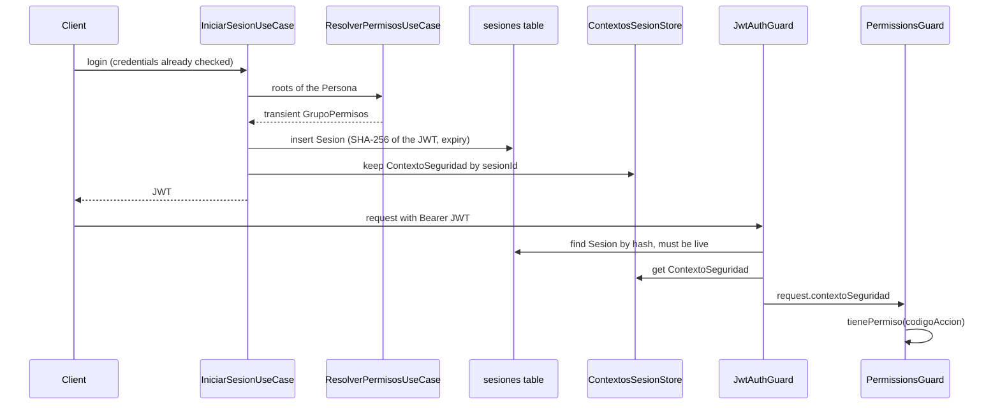

# Security module alignment (epic #25): what was built and which patterns it uses

How the security module was aligned with the academic spec (UAI *Trabajo de Diploma*, v8.0), with
the real code behind each point.

- **Source:** commit `126131e`, the head of `epic/25-security-module-alignment` (PR #34 into `main`).
- **Excerpts:** every snippet below is copied from that commit by line range, with its path and line
  numbers above it, so a line reference stays checkable.
- **Naming:** identifiers in the security scope take the spec's Spanish names literally
  (`Usuario`, `ComponentePermiso`, `Sesion`, `ContextoSeguridad`, …) per ADR-0023. Code comments are in English.
- **Terms and invariants:** the numbered invariants cited here (2, 3, 10–14) live in
  `.agents/ubiquitous-language-invariants.md`; the vocabulary lives in `.agents/ubiquitous-language.md`.

## 1. What the epic delivered

Eight child issues, each implemented by a headless agent, passed through an agentic review, and
approved by a human before the runner merged it into the epic branch.

| Child | Slice |
|-------|-------|
| #26 | `Usuario` identity: `autenticar`, `incrementarIntentos`, `obtenerRol`, and the `ListaUsuarios` catalog port |
| #27 | The permission matrix persisted as a tree, one default-roots factory per role, and the `Administrador` role (4 rework rounds) |
| #28 | `Sesion`: a persisted login session, required to be live on every authenticated request, plus logout |
| #29 | Eight Administrador endpoints that manage the matrix (CU-15), and a grouped `GET /security/matrix` |
| #30 | Permission-aware web: sidebar, routes and buttons follow the caller's permissions |
| #31 | One `Accion` per protected endpoint, and an audit test that enforces it |
| #32 | The matrix administration screen |
| #33 | Documentation and runbook updates |

## 2. Patterns at a glance

| Pattern | Where | What it does here |
|---------|-------|-------------------|
| **Composite** (mandatory in the spec) | `ComponentePermiso`, `GrupoPermisos`, `Accion` | One permission tree; a group grants what any child grants, a leaf grants one code |
| **Abstract Factory** (mandatory in the spec) | `MatrizPermisosFactory` and three role factories | Defines each role's default roots and seeds/hands them out |
| **Use-case (hexagonal) architecture** | `modules/*/{domain,application,infrastructure,presentation}` | Domain and ports know nothing of Nest or Drizzle; use cases orchestrate |
| **Repository / Catalog** | `ListaUsuarios`, `SesionRepository`, `ComponentePermisoRepository` | Persistence behind interfaces; users are queried through the catalog |
| **Guard + metadata decorator** | `@RequiereAccion`, `JwtAuthGuard`, `PermissionsGuard` | Each endpoint declares its Accion; the guard checks it |
| **Context object + in-memory store** | `ContextoSeguridad`, `ContextosSesionStore` | A Sesion's permissions are resolved once, at login |
| **Transactional writes** | `reemplazarHijos`, `eliminarGrupo` | A multi-row matrix change commits or rolls back as a unit |
| **Domain errors mapped at the edge** | `aHttp` in the admin controller | Use cases throw domain errors; the controller maps them to 404 / 400 / 409 |
| **Architecture audit test** | `endpoint-permissions.audit.spec.ts` | Fails the build when an endpoint has no Accion |
| **Service → query hooks → gated views** (web) | `security_service`, `usePermissions`, `RoutePermissionGuard` | Server state in hooks; the UI hides what the caller may not do |

## 3. Composite: the permission tree

The spec models permissions as a tree. `ComponentePermiso` is the abstract component. Its leaf and
composite override `evaluar`, and the leaf refuses children.

`apps/api/src/modules/security/domain/componente-permiso.ts` · lines 1–19

```ts
/** SPEC 19.13 Composite component. Nodes are shared: at most one parent (`contiene`), yet any number of Personas may hold a node as a root (invariant 12). */
export abstract class ComponentePermiso {
  constructor(
    public readonly id: string,
    public readonly nombre: string,
  ) {}

  abstract evaluar(codigoAccion: string): boolean;

  abstract obtenerHijos(): ComponentePermiso[];

  agregar(_hijo: ComponentePermiso): void {
    throw new Error(`${this.nombre} no admite hijos`);
  }

  remover(_hijo: ComponentePermiso): void {
    throw new Error(`${this.nombre} no admite hijos`);
  }
}
```

`GrupoPermisos` is the composite. `evaluar` is the OR of its children, by recursive traversal:

`apps/api/src/modules/security/domain/grupo-permisos.ts` · lines 3–34

```ts
/** SPEC 19.13 composite: the only interior node of a tree; `evaluar` is the OR of its children. */
export class GrupoPermisos extends ComponentePermiso {
  private readonly hijos: ComponentePermiso[] = [];

  constructor(
    id: string,
    nombre: string,
    public readonly descripcion: string | null = null,
  ) {
    super(id, nombre);
  }

  evaluar(codigoAccion: string): boolean {
    return this.hijos.some((hijo) => hijo.evaluar(codigoAccion));
  }

  obtenerHijos(): ComponentePermiso[] {
    return this.hijos;
  }

  agregar(hijo: ComponentePermiso): void {
    this.hijos.push(hijo);
  }

  remover(hijo: ComponentePermiso): void {
    const index = this.hijos.findIndex((actual) => actual.id === hijo.id);

    if (index >= 0) {
      this.hijos.splice(index, 1);
    }
  }
}
```

`Accion` is the leaf. It matches its own code exactly and has no children:

`apps/api/src/modules/security/domain/accion.ts` · lines 3–21

```ts
/** SPEC 19.13 leaf: one permitted action, identified by `codigoAccion` and executed in one Formulario. */
export class Accion extends ComponentePermiso {
  constructor(
    id: string,
    nombre: string,
    public readonly codigoAccion: string,
    public readonly formularioId: string,
  ) {
    super(id, nombre);
  }

  evaluar(codigoAccion: string): boolean {
    return codigoAccion === this.codigoAccion;
  }

  obtenerHijos(): ComponentePermiso[] {
    return [];
  }
}
```

`ContextoSeguridad` holds the tree of one Sesion's Persona and answers for it. `tienePermiso` is a
single delegation to the root, which is the whole point of the pattern:

`apps/api/src/modules/security/domain/contexto-seguridad.ts` · lines 4–31

```ts
export class ContextoSeguridad {
  private root: ComponentePermiso;

  constructor(root: ComponentePermiso) {
    this.root = root;
  }

  cargarMatriz(componente: ComponentePermiso): void {
    this.root = componente;
  }

  tienePermiso(codigoAccion: string): boolean {
    return this.root.evaluar(codigoAccion);
  }

  /** Every permitted `codigoAccion` once, even when a group is reachable through several roots. */
  listarAcciones(): string[] {
    return [...new Set(this.flatten(this.root))];
  }

  private flatten(componente: ComponentePermiso): string[] {
    if (componente instanceof Accion) {
      return [componente.codigoAccion];
    }

    return componente.obtenerHijos().flatMap((hijo) => this.flatten(hijo));
  }
}
```

**A Persona holds one or more roots** (invariant 12), but the spec's `resolverPermisos()` returns a
single component. The use case reconciles the two by wrapping the roots in a transient group that is
never persisted:

`apps/api/src/modules/security/application/use-cases/resolver-permisos.use-case.ts` · lines 19–43

```ts
  /**
   * Returns a transient, never-persisted GrupoPermisos over the Persona's roots, so 19.13's single-component
   * `resolverPermisos(): ComponentePermiso` and `cargarMatriz(componente)` stay literal while a Persona holds 1..* roots.
   * Without a Persona the group is empty, which denies everything.
   */
  async execute(usuarioId: string): Promise<ComponentePermiso> {
    this.logger.debug(`Resolving permission tree for usuarioId=${usuarioId}`);

    const persona = await this.personaRepository.findByUsuarioId(usuarioId);

    if (!persona) {
      this.logger.warn(`Usuario without Persona, every permission denied usuarioId=${usuarioId}`);

      return new GrupoPermisos(`usuario:${usuarioId}`, "Sin Persona");
    }

    const raices = await this.componenteRepository.findArbolByPersona(persona.id);
    const arbol = new GrupoPermisos(`persona:${persona.id}`, "Raíces de la Persona");

    for (const raiz of raices) {
      arbol.agregar(raiz);
    }

    return arbol;
  }
```

Nodes are shared: a node has at most one parent, yet any number of Personas may hold it as a root.
That is why a role's default is a *set* of shared root groups rather than one group per role.

## 4. Abstract Factory: default roots per role

The seed catalog is pure data. Each group and each Accion is described by a permanent id:

`apps/api/src/modules/security/domain/catalogo-matriz.ts` · lines 18–33

```ts
export interface GrupoDefinicion {
  id: string;
  nombre: string;
  descripcion: string;
  padreId: string | null;
}

export interface AccionDefinicion {
  codigoAccion: string;
  nombre: string;
  formularioId: string;
  /** Id of the default group the Accion is first seeded under; a later move by an Administrador survives a re-sync. */
  grupoPorDefecto: string;
  /** The use cases the Accion traces to. */
  cu: readonly CasoDeUso[];
}
```

The factory interface is the Abstract Factory. A role factory *defines* its default roots and
*seeds* the shared groups; it never builds the runtime tree a Sesion uses (that is loaded from the
database):

`apps/api/src/modules/security/application/factories/matriz-permisos.factory.ts` · lines 10–25

```ts
/**
 * Abstract Factory, one per role: defines the role's default roots, seeds their shared groups and hands them to a Persona.
 * A new Persona is created holding `raicesPorDefecto()` in one transaction (invariant 12); `otorgarRaices` is the
 * reconcile path for a Persona found holding none.
 */
export interface MatrizPermisosFactory {
  readonly tipo: PersonaTipo;
  /** The role's default roots: ids of shared default groups. */
  raicesPorDefecto(): readonly string[];
  /** In-memory build of the role's default trees (documents and tests the role's grants; never persisted from here). */
  crear(): ComponentePermiso[];
  /** Seeds this role's shared default groups (and their subgroups) when missing. */
  sembrar(): Promise<void>;
  /** Hands an existing Persona this role's default roots; ignores the ones it already holds. */
  otorgarRaices(personaId: string): Promise<void>;
}
```

The base class implements the shared mechanics once. `crear()` builds an in-memory tree from the
catalog, `sembrar()` writes the groups, and `otorgarRaices()` hands them to a Persona:

`apps/api/src/modules/security/application/factories/matriz-permisos.factory.ts` · lines 29–64

```ts
/** Plain classes, not `@Injectable`, so the seed script can build them too. */
abstract class MatrizPermisosFactoryBase implements MatrizPermisosFactory {
  abstract readonly tipo: PersonaTipo;

  constructor(private readonly repository: ComponentePermisoRepository) {}

  abstract raicesPorDefecto(): readonly string[];

  crear(): ComponentePermiso[] {
    return this.raicesPorDefecto().map((id) => this.construirGrupo(grupoPorId(id)));
  }

  async sembrar(): Promise<void> {
    const grupos = this.raicesPorDefecto().flatMap((id) => conDescendientes(grupoPorId(id)));

    await this.repository.asegurarGrupos(grupos);
  }

  async otorgarRaices(personaId: string): Promise<void> {
    await this.repository.asignarRaices(personaId, this.raicesPorDefecto());
  }

  private construirGrupo(definicion: GrupoDefinicion): GrupoPermisos {
    const grupo = new GrupoPermisos(definicion.id, definicion.nombre, definicion.descripcion);

    for (const subgrupo of subgruposDe(definicion)) {
      grupo.agregar(this.construirGrupo(subgrupo));
    }

    for (const accion of accionesPorDefectoDe(definicion)) {
      grupo.agregar(new Accion(accion.codigoAccion, accion.nombre, accion.codigoAccion, accion.formularioId));
    }

    return grupo;
  }
}
```

Each role is then only a choice of roots. The Administrador sees account and administration groups:

`apps/api/src/modules/security/application/factories/matriz-permisos.factory.ts` · lines 84–90

```ts
export class AdministradorMatrizFactory extends MatrizPermisosFactoryBase {
  readonly tipo = "administrador";

  raicesPorDefecto(): readonly string[] {
    return [GRUPOS.CUENTA.id, GRUPOS.ADMIN_PERMISOS.id, GRUPOS.ADMIN_USUARIOS.id];
  }
}
```

The Postulante keeps what it can do today, including two interim grants until the Recruiter side of
the pipeline is split out:

`apps/api/src/modules/security/application/factories/matriz-permisos.factory.ts` · lines 66–74

```ts
export class PostulanteMatrizFactory extends MatrizPermisosFactoryBase {
  readonly tipo = "postulante";

  // PIPELINE and SEGUIMIENTO are interim grants: the Postulante keeps what it can do today until the
  // Recruiter side of the pipeline is split out (.agents/specs/2026-10-12-security-module-spec-alignment.md).
  raicesPorDefecto(): readonly string[] {
    return [GRUPOS.CUENTA.id, GRUPOS.PERFILES.id, GRUPOS.ANALITICA.id, GRUPOS.PIPELINE.id, GRUPOS.SEGUIMIENTO.id];
  }
}
```

The factories are plain classes, not `@Injectable`, so the seed script can build them too. Nest
receives them through a factory provider:

`apps/api/src/modules/security/application/factories/matriz-permisos.factory.ts` · lines 92–98

```ts
export function crearFactories(repository: ComponentePermisoRepository): MatrizPermisosFactories {
  return {
    postulante: new PostulanteMatrizFactory(repository),
    recruiter: new RecruiterMatrizFactory(repository),
    administrador: new AdministradorMatrizFactory(repository),
  };
}
```

`apps/api/src/modules/security/security.module.ts` · lines 42–42

```ts
    { provide: MATRIZ_PERMISOS_FACTORIES, inject: [COMPONENTE_PERMISO_REPOSITORY], useFactory: crearFactories },
```

Registration hands a new Persona its role's roots when it is created, so a Persona never exists
without roots (invariant 12):

`apps/api/src/modules/auth/application/use-cases/register.use-case.ts` · lines 47–49

```ts
    // The Persona is created holding its role's default roots, in one transaction: it never exists without roots
    // (invariant 12), and when the grant fails no Persona is left behind and no token is signed.
    const raices = this.factories[input.role].raicesPorDefecto();
```

## 5. Use-case architecture and ports

Each module separates the domain, its ports, the use cases, and the adapters:

```text
apps/api/src/modules/security/
├── domain/            Composite classes, ports (ComponentePermisoRepository), domain errors, seed catalog
├── application/       use cases (including the nine added by #29), role factories
├── infrastructure/    DrizzleComponentePermisoRepository
└── presentation/      AdministracionMatrizController, SecurityController
```

`ListaUsuarios` is the spec's «Catálogo»: a question about users goes to the catalog, never to a
single `Usuario`:

`apps/api/src/modules/users/domain/lista-usuarios.repository.ts` · lines 11–19

```ts
/** SPEC 19.13 «Catálogo» of Usuarios: a query about users goes to the catalog, never to a single Usuario. */
export interface ListaUsuarios {
  agregarUsuario(nuevo: NuevoUsuario): Promise<Usuario>;
  buscarPorEmail(email: string): Promise<Usuario | null>;
  buscarPorId(id: string): Promise<Usuario | null>;
  listar(): Promise<Usuario[]>;
  /** Persists the mutable state of a Usuario (`nombreCompleto`, `intentosFallidos`). */
  guardar(usuario: Usuario): Promise<void>;
}
```

`Usuario` keeps `passwordHash` private (invariant 3) and stores no role: `obtenerRol()` returns its
Persona's type (invariant 2):

`apps/api/src/modules/users/domain/usuario.ts` · lines 4–35

```ts
/** SPEC 19.13 `Usuario`. Holds `passwordHash` privately — it never leaves apps/api (invariant 3). */
export class Usuario {
  constructor(
    public readonly id: string,
    public readonly email: string,
    public readonly nombreCompleto: string,
    private readonly passwordHash: string | null,
    public readonly authProvider: string,
    private intentos: number,
    private readonly tipoPersona: PersonaTipo | null,
  ) {}

  get intentosFallidos(): number {
    return this.intentos;
  }

  async autenticar(password: string, hasher: PasswordHasher): Promise<boolean> {
    if (!this.passwordHash) {
      return false;
    }

    return hasher.compare(password, this.passwordHash);
  }

  incrementarIntentos(): void {
    this.intentos += 1;
  }

  /** SPEC 19.2 `obtenerRol()`: the role is the Persona's `tipo`; the Usuario stores none (invariant 2). */
  obtenerRol(): PersonaTipo | null {
    return this.tipoPersona;
  }
```

A use case depends on the port, throws domain errors, and carries the invariant it enforces.
Removing a root never removes the last one:

`apps/api/src/modules/security/application/use-cases/remover-raiz.use-case.ts` · lines 6–34

```ts
/** CU-15: takes a root from a Persona, never its last one (invariant 12, RF_Core_14). Touches no live Sesion — the change applies from the Persona's next login (invariant 13). */
@Injectable()
export class RemoverRaizUseCase {
  constructor(
    @Inject(COMPONENTE_PERMISO_REPOSITORY) private readonly componenteRepository: ComponentePermisoRepository,
    private readonly logger: AppLogger,
  ) {
    this.logger.setContext(RemoverRaizUseCase.name);
  }

  async execute(personaId: string, componenteId: string): Promise<void> {
    if (!(await this.componenteRepository.buscarPersona(personaId))) {
      throw new PersonaNoEncontradaError(personaId);
    }

    const raices = await this.componenteRepository.raicesDePersona(personaId);

    if (!raices.includes(componenteId)) {
      throw new RaizNoAsignadaError(personaId, componenteId);
    }

    if (raices.length === 1) {
      throw new UltimaRaizError(personaId);
    }

    await this.componenteRepository.removerRaiz(personaId, componenteId);

    this.logger.log(`Root ${componenteId} removed from Persona ${personaId}`);
  }
```

## 6. The Sesion lifecycle

A Sesion is persisted at login, must be live on every request, and initializes its
`ContextoSeguridad` once. Permissions are therefore resolved at login and never again during the
Sesion (invariant 13), so a grant change applies from the next login.



**The token is never stored, only its hash** (invariant 14):

`apps/api/src/shared/auth/token-hash.ts` · lines 3–6

```ts
/** SHA-256 hex of a JWT: what a Sesion stores in place of the token (invariant 14). */
export function hashToken(token: string): string {
  return createHash("sha256").update(token).digest("hex");
}
```

The `sesiones` table makes the hash unique, and a row is never deleted:

`apps/api/src/database/schema/sesiones.schema.ts` · lines 4–14

```ts
// A Usuario's login sessions (`Usuario 1—0..* Sesion`, invariant 12). A row is never deleted: a Sesion ends by expiry (invariant 14).
export const sesiones = pgTable("sesiones", {
  id: uuid("id").primaryKey().defaultRandom(),
  usuarioId: uuid("usuario_id")
    .notNull()
    .references(() => usuarios.id),
  /** SHA-256 hex of the issued JWT — never the token itself (invariant 14). */
  tokenJWT: text("token_jwt").notNull().unique(),
  fechaEmision: timestamp("fecha_emision", { withTimezone: true }).notNull().defaultNow(),
  fechaExpiracion: timestamp("fecha_expiracion", { withTimezone: true }).notNull(),
});
```

Because the hash is unique, two logins in the same second must not sign the same JWT, so each token
carries a random `jti`:

`apps/api/src/shared/auth/jwt.service.ts` · lines 24–32

```ts
  sign(payload: JwtPayload): string {
    return this.nestJwtService.sign(
      { ...payload, jti: randomUUID() },
      {
        secret: this.configService.get("JWT_SECRET", { infer: true }),
        expiresIn: this.configService.get("JWT_EXPIRES_IN", { infer: true }),
      },
    );
  }
```

Starting a Sesion. The permissions are resolved *before* the row is inserted, so a failure leaves no
live Sesion behind:

`apps/api/src/modules/auth/application/use-cases/iniciar-sesion.use-case.ts` · lines 23–44

```ts
  async execute(usuarioId: string, role: PersonaTipo): Promise<string> {
    this.logger.debug(`Starting sesion usuarioId=${usuarioId}`);

    const token = this.jwtService.sign({ sub: usuarioId, role });
    const { exp } = this.jwtService.verify(token);

    if (exp === undefined) {
      throw new Error("Signed token carries no expiry");
    }

    // Resolved before the row exists, so a failure here leaves no live Sesion behind.
    const raiz = await this.resolverPermisosUseCase.execute(usuarioId);
    const fechaExpiracion = new Date(exp * 1000);
    const sesion = await this.sesiones.crear({ usuarioId, tokenJWT: hashToken(token), fechaEmision: new Date(), fechaExpiracion });
    const contexto = sesion.inicializarContextoSeguridad(raiz);

    this.contextos.guardar(sesion.id, contexto, fechaExpiracion);

    this.logger.log(`Sesion started id=${sesion.id} usuarioId=${usuarioId}`);

    return token;
  }
```

The entity ends by expiry, never by deletion, and refuses a second context initialization:

`apps/api/src/modules/auth/domain/sesion.ts` · lines 27–50

```ts
  estaVigente(ahora: Date = new Date()): boolean {
    return this.expiracion.getTime() > ahora.getTime();
  }

  /** Logout or forced end: the expiry moves to now and the row stays. It never extends a Sesion that already ended. */
  cerrar(ahora: Date = new Date()): void {
    if (this.estaVigente(ahora)) {
      this.expiracion = ahora;
    }
  }

  /**
   * SPEC 18.10: the Sesion initializes its ContextoSeguridad from the Persona's resolved permissions, once, when it
   * starts (invariant 13). A second call would re-resolve the permissions mid-Sesion, so it is refused.
   */
  inicializarContextoSeguridad(raiz: ComponentePermiso): ContextoSeguridad {
    if (this.contexto) {
      throw new Error(`ContextoSeguridad already initialized sesionId=${this.id}`);
    }

    this.contexto = new ContextoSeguridad(raiz);

    return this.contexto;
  }
```

The context lives in memory by `sesionId`:

`apps/api/src/modules/auth/application/contextos-sesion.store.ts` · lines 9–29

```ts
/**
 * The ContextoSeguridad each live Sesion initialized when it started (invariant 13), by `sesionId`. In memory and
 * single-instance: a process that lost an entry (restart) cannot rebuild it without re-resolving permissions
 * mid-Sesion, so `ValidarSesionUseCase` ends that Sesion instead.
 */
@Injectable()
export class ContextosSesionStore {
  private readonly contextos = new Map<string, ContextoDeSesion>();

  guardar(sesionId: string, contexto: ContextoSeguridad, fechaExpiracion: Date): void {
    this.descartarVencidos();
    this.contextos.set(sesionId, { contexto, fechaExpiracion });
  }

  obtener(sesionId: string): ContextoSeguridad | undefined {
    return this.contextos.get(sesionId)?.contexto;
  }

  eliminar(sesionId: string): void {
    this.contextos.delete(sesionId);
  }
```

Validating a request. If the process restarted, the context is gone. Re-resolving it would let a
grant change reach a live Sesion, so the Sesion ends instead:

`apps/api/src/modules/auth/application/use-cases/validar-sesion.use-case.ts` · lines 24–44

```ts
  async execute(token: string): Promise<SesionVigente | null> {
    const sesion = await this.sesiones.buscarPorToken(hashToken(token));

    if (!sesion?.estaVigente()) {
      return null;
    }

    const contexto = this.contextos.obtener(sesion.id);

    if (!contexto) {
      // The process restarted, so the context resolved when the Sesion started is gone. Re-resolving it here would let a
      // grant change reach a Sesion before its next login (invariant 13): the Sesion ends instead.
      this.logger.warn(`Sesion has no ContextoSeguridad in this process, ending it id=${sesion.id}`);
      sesion.cerrar();
      await this.sesiones.guardar(sesion);

      return null;
    }

    return { sesionId: sesion.id, contexto };
  }
```

Logout moves the expiry to now and keeps the row:

`apps/api/src/modules/auth/application/use-cases/cerrar-sesion.use-case.ts` · lines 17–28

```ts
  async execute(sesionId: string): Promise<void> {
    const sesion = await this.sesiones.buscarPorId(sesionId);

    if (sesion) {
      sesion.cerrar();
      await this.sesiones.guardar(sesion);
    }

    this.contextos.eliminar(sesionId);

    this.logger.log(`Sesion closed id=${sesionId}`);
  }
```

## 7. Guards, the decorator, and the audit test

An endpoint declares its Accion with a metadata decorator:

`apps/api/src/common/decorators/requiere-accion.decorator.ts` · lines 1–5

```ts
import { SetMetadata } from "@nestjs/common";

export const REQUIERE_ACCION_KEY = "requiereAccion";

export const RequiereAccion = (codigoAccion: string) => SetMetadata(REQUIERE_ACCION_KEY, codigoAccion);
```

A controller applies both guards, in order, and tags each handler:

`apps/api/src/modules/branches/presentation/branches.controller.ts` · lines 27–28

```ts
@UseGuards(JwtAuthGuard, PermissionsGuard)
@Controller("branches")
```

`apps/api/src/modules/branches/presentation/branches.controller.ts` · lines 58–59

```ts
  @Post()
  @RequiereAccion("branch.create")
```

`JwtAuthGuard` authenticates the token, then requires a live Sesion, and attaches the context to the
request:

`apps/api/src/shared/auth/jwt-auth.guard.ts` · lines 9–48

```ts
/**
 * Authenticates a request: a valid bearer token that names a live Sesion (database lookup on every request). On success
 * the request carries `user` (the token claims), `sesionId` and the `contextoSeguridad` the Sesion initialized when it
 * started, which `PermissionsGuard` and `@ContextoActual()` read.
 */
@Injectable()
export class JwtAuthGuard implements CanActivate {
  constructor(
    private readonly jwtService: JwtService,
    private readonly validarSesionUseCase: ValidarSesionUseCase,
  ) {}

  async canActivate(context: ExecutionContext): Promise<boolean> {
    const request = context.switchToHttp().getRequest<AuthorizedRequest>();
    const token = this.extractToken(request);

    if (!token) {
      throw new UnauthorizedException("Missing bearer token");
    }

    let payload: JwtPayload;

    try {
      payload = this.jwtService.verify(token);
    } catch {
      throw new UnauthorizedException("Invalid or expired token");
    }

    const vigente = await this.validarSesionUseCase.execute(token);

    if (!vigente) {
      throw new UnauthorizedException("Sesión inválida o expirada");
    }

    request.user = payload;
    request.sesionId = vigente.sesionId;
    request.contextoSeguridad = vigente.contexto;

    return true;
  }
```

`PermissionsGuard` only *reads* that context. It never resolves permissions itself:

`apps/api/src/common/guards/permissions.guard.ts` · lines 6–30

```ts
/** Checks the action a handler requires against the ContextoSeguridad its Sesion initialized; it never resolves permissions itself (invariant 13). */
@Injectable()
export class PermissionsGuard implements CanActivate {
  constructor(private readonly reflector: Reflector) {}

  canActivate(context: ExecutionContext): boolean {
    const codigoAccion = this.reflector.getAllAndOverride<string | undefined>(REQUIERE_ACCION_KEY, [context.getHandler(), context.getClass()]);

    if (!codigoAccion) {
      return true;
    }

    const { contextoSeguridad } = context.switchToHttp().getRequest<AuthorizedRequest>();

    // Only reachable when PermissionsGuard runs without JwtAuthGuard before it, a programming error: deny.
    if (!contextoSeguridad) {
      throw new ForbiddenException("ContextoSeguridad missing — PermissionsGuard must run after JwtAuthGuard");
    }

    if (!contextoSeguridad.tienePermiso(codigoAccion)) {
      throw new ForbiddenException(`Missing permission: ${codigoAccion}`);
    }

    return true;
  }
```

Note the first branch: a handler without `@RequiereAccion` is let through. That is why the audit test
exists. It reflects over every `*.controller.ts` under `src/modules`, so a controller added later is
audited without editing the test:

`apps/api/src/common/guards/endpoint-permissions.audit.spec.ts` · lines 11–12

```ts
/** The only endpoints invariant 10 exempts. */
const PUBLICOS = new Set(["AuthController.register", "AuthController.login", "HealthController.check"]);
```

`apps/api/src/common/guards/endpoint-permissions.audit.spec.ts` · lines 66–89

```ts
  it("finds the public handlers, and only they carry no code", () => {
    const publicos = endpoints.filter((endpoint) => PUBLICOS.has(endpoint.nombre));

    expect(publicos.map((endpoint) => endpoint.nombre).sort()).toEqual([...PUBLICOS].sort());
    expect(publicos.filter((endpoint) => endpoint.codigo !== undefined).map((endpoint) => `${endpoint.nombre} -> ${endpoint.codigo}`)).toEqual([]);
  });

  it("gives every other handler a code", () => {
    expect(
      protegidos()
        .filter((endpoint) => !endpoint.codigo)
        .map((endpoint) => `${endpoint.nombre} has no @RequiereAccion`),
    ).toEqual([]);
  });

  it("guards every other handler with JwtAuthGuard and then PermissionsGuard", () => {
    const sinGuards = protegidos()
      .filter((endpoint) => {
        const jwt = endpoint.guards.indexOf(JwtAuthGuard);
        const permisos = endpoint.guards.indexOf(PermissionsGuard);

        return jwt === -1 || permisos === -1 || jwt > permisos;
      })
      .map((endpoint) => `${endpoint.nombre} must run JwtAuthGuard before PermissionsGuard`);
```

## 8. The matrix administration API

Eight endpoints, each behind its own Accion from the seeded catalog (CU-15):

| Method and path | Accion |
|-----------------|--------|
| `GET /security/catalog` | `security.viewCatalog` |
| `GET /security/groups` | `security.listGroups` |
| `POST /security/groups` | `security.createGroup` |
| `PATCH /security/groups/:id` | `security.updateGroup` |
| `DELETE /security/groups/:id` | `security.deleteGroup` |
| `GET /security/personas` | `security.listPersonas` |
| `POST /security/personas/:personaId/roots` | `security.assignRoot` |
| `DELETE /security/personas/:personaId/roots/:componenteId` | `security.removeRoot` |

The controller maps domain errors to HTTP at the edge, so use cases stay free of HTTP concerns:

`apps/api/src/modules/security/presentation/administracion-matriz.controller.ts` · lines 36–50

```ts
function aHttp(error: unknown): never {
  if (error instanceof ComponenteNoEncontradoError || error instanceof PersonaNoEncontradaError || error instanceof RaizNoAsignadaError) {
    throw new NotFoundException(error.message);
  }

  if (error instanceof NoEsGrupoError || error instanceof CicloEnMatrizError) {
    throw new BadRequestException(error.message);
  }

  if (error instanceof UltimaRaizError || error instanceof GrupoEnUsoComoRaizError) {
    throw new ConflictException(error.message);
  }

  throw error;
}
```

`apps/api/src/modules/security/presentation/administracion-matriz.controller.ts` · lines 52–55

```ts
/** CU-15: the Administrador's management of the permission matrix. Every handler carries its own Accion (invariant 10). */
@Controller("security")
@UseGuards(JwtAuthGuard, PermissionsGuard)
export class AdministracionMatrizController {
```

`apps/api/src/modules/security/presentation/administracion-matriz.controller.ts` · lines 67–77

```ts
  @Get("catalog")
  @RequiereAccion("security.viewCatalog")
  catalog(): Promise<CatalogoMatriz> {
    return this.obtenerCatalogoUseCase.execute();
  }

  @Get("groups")
  @RequiereAccion("security.listGroups")
  listGroups(): Promise<GrupoPermisosModel[]> {
    return this.listarGruposUseCase.execute();
  }
```

Moving nodes must never create a cycle. The repository walks the ancestors in memory (the whole
matrix is a few dozen rows) and stops on an existing cycle:

`apps/api/src/modules/security/infrastructure/drizzle-componente-permiso.repository.ts` · lines 173–187

```ts
  async ancestros(id: string): Promise<string[]> {
    // The whole matrix is a few dozen rows, so walking it in memory beats a recursive query.
    const filas = await this.db.select({ id: componentes.id, padreId: componentes.padreId }).from(componentes);
    const padres = new Map(filas.map(({ id: filaId, padreId }) => [filaId, padreId]));
    const cadena: string[] = [];
    let actual = padres.get(id) ?? null;

    // `cadena.includes` stops a walk over a cycle that the use cases forbid but the table cannot rule out.
    while (actual !== null && !cadena.includes(actual)) {
      cadena.push(actual);
      actual = padres.get(actual) ?? null;
    }

    return cadena;
  }
```

Changes that touch several rows run in one transaction. Replacing a group's children detaches the
old ones and attaches the new ones together:

`apps/api/src/modules/security/infrastructure/drizzle-componente-permiso.repository.ts` · lines 213–227

```ts
  async reemplazarHijos(grupoId: string, hijoIds: readonly string[]): Promise<void> {
    await this.db.transaction(async (tx) => {
      await tx
        .update(componentes)
        .set({ padreId: null })
        .where(and(eq(componentes.padreId, grupoId), hijoIds.length > 0 ? notInArray(componentes.id, [...hijoIds]) : undefined));

      if (hijoIds.length > 0) {
        await tx
          .update(componentes)
          .set({ padreId: grupoId })
          .where(inArray(componentes.id, [...hijoIds]));
      }
    });
  }
```

Deleting a group re-parents its children to the group's own parent, then deletes it:

`apps/api/src/modules/security/infrastructure/drizzle-componente-permiso.repository.ts` · lines 229–240

```ts
  async eliminarGrupo(id: string): Promise<void> {
    await this.db.transaction(async (tx) => {
      const [grupo] = await tx.select({ padreId: componentes.padreId }).from(componentes).where(eq(componentes.id, id));

      if (!grupo) {
        return;
      }

      await tx.update(componentes).set({ padreId: grupo.padreId }).where(eq(componentes.padreId, id));
      await tx.delete(componentes).where(eq(componentes.id, id));
    });
  }
```

## 9. The web: showing only what the caller may do

The server checks every request on its own. The web follows the same permissions so it never offers
what would fail, and hiding is UX, not security.

A single config maps routes and buttons to the codes they need:

`apps/web/config/permissions.config.ts` · lines 4–25

```ts
/** Every screen and the codigoAccion its data needs (decision 14). Dynamic segments use `[param]`. */
export const ROUTE_PERMISSIONS = [
  { route: "/", codigoAccion: "branch.list" },
  { route: "/branches", codigoAccion: "branch.list" },
  { route: "/branches/[id]", codigoAccion: "branch.view" },
  { route: "/analytics", codigoAccion: "analytics.overview" },
  { route: "/followup", codigoAccion: "followup.list" },
  { route: "/profiles", codigoAccion: "cv.list" },
  { route: "/admin/permisos", codigoAccion: "security.listGroups" },
] as const;

/** Buttons and the codigoAccion each one needs. */
export const ACTION_PERMISSIONS = {
  createBranch: ["branch.create", "cv.list"], // the dialog loads the CV versions it applies with
  cloneBranch: ["branch.clone"],
  archiveBranch: ["branch.archive"],
  addHito: ["branch.addHito"],
  createCvVersion: ["cv.create"],
  uploadCv: ["cv.upload"],
  setOutputProfile: ["cv.setOutput"],
  resolveFollowup: ["followup.resolve"],
} as const satisfies Record<string, readonly string[]>;
```

One hook turns the session's `permisos` into `can` and `canDo`:

`apps/web/hooks/use-permissions.ts` · lines 5–12

```ts
export const usePermissions = () => {
  const { session, isPending } = useSession();
  const permisos = useMemo(() => new Set(session?.permisos ?? []), [session]);
  const can = useCallback((...codigos: readonly string[]) => codigos.every((codigo) => permisos.has(codigo)), [permisos]);
  const canDo = useCallback((action: ActionKey) => can(...ACTION_PERMISSIONS[action]), [can]);

  return { permisos, can, canDo, isPending, isLoaded: session !== undefined };
};
```

A route guard redirects a route the Persona may not open. A session that failed to load is not "no
permissions", so it renders instead of redirecting:

`apps/web/components/route-permission-guard.tsx` · lines 8–30

```tsx
/**
 * Redirects a route the Persona may not open. Hiding is UX, not security: the server checks every
 * request on its own. A session that failed to load is not "no permissions", so it renders the
 * children rather than redirecting to /signin, where the GuestGuard would send a still-valid token back.
 */
export function RoutePermissionGuard({ children }: { children: React.ReactNode }) {
  const pathname = usePathname();
  const router = useRouter();
  const { permisos, can, isPending, isLoaded } = usePermissions();

  const codigo = codigoParaRuta(pathname);
  const blocked = !isPending && isLoaded && codigo !== undefined && !can(codigo);

  useEffect(() => {
    if (blocked) {
      router.replace(primeraRutaPermitida(permisos) ?? "/signin");
    }
  }, [blocked, permisos, router]);

  if (isPending || blocked) return null;

  return <>{children}</>;
}
```

Data access goes through a service whose types come from `@repo/models`, never re-declared in the
app (invariant 11):

`apps/web/services/security.service.ts` · lines 1–21

```ts
import type { AsignarRaizInput, CatalogoMatriz, CreateGrupoPermisosInput, GrupoPermisos, PersonaRaices, TResult, UpdateGrupoPermisosInput } from "@/models";
import { api } from "@/utilities/api.utility";

export const security_service = {
  catalog: (signal?: AbortSignal): Promise<TResult<CatalogoMatriz>> => api.get<CatalogoMatriz>("/security/catalog", undefined, signal),

  groups: (signal?: AbortSignal): Promise<TResult<GrupoPermisos[]>> => api.get<GrupoPermisos[]>("/security/groups", undefined, signal),

  createGroup: (input: CreateGrupoPermisosInput): Promise<TResult<GrupoPermisos>> => api.post<CreateGrupoPermisosInput, GrupoPermisos>("/security/groups", input),

  updateGroup: (id: string, input: UpdateGrupoPermisosInput): Promise<TResult<GrupoPermisos>> =>
    api.patch<UpdateGrupoPermisosInput, GrupoPermisos>(`/security/groups/${id}`, input),

  deleteGroup: (id: string): Promise<TResult<void>> => api.delete<void>(`/security/groups/${id}`),

  personas: (signal?: AbortSignal): Promise<TResult<PersonaRaices[]>> => api.get<PersonaRaices[]>("/security/personas", undefined, signal),

  assignRoot: (personaId: string, componenteId: string): Promise<TResult<void>> => api.post<AsignarRaizInput, void>(`/security/personas/${personaId}/roots`, { componenteId }),

  removeRoot: (personaId: string, componenteId: string): Promise<TResult<void>> => api.delete<void>(`/security/personas/${personaId}/roots/${componenteId}`),
};
```

Mutations invalidate exactly the queries they affect. Deleting a group refreshes groups, the
catalog, and the Personas' roots:

`apps/web/hooks/use-delete-permission-group.ts` · lines 4–15

```ts
export const useDeletePermissionGroup = () => {
  const queryClient = useQueryClient();

  return useMutation({
    mutationFn: (id: string) => security_service.deleteGroup(id),
    onSuccess: () => {
      queryClient.invalidateQueries({ queryKey: ["security", "groups"] });
      queryClient.invalidateQueries({ queryKey: ["security", "catalog"] });
      queryClient.invalidateQueries({ queryKey: ["security", "personas"] });
    },
  });
};
```

The admin screen gates each control by its Accion. "Eliminar" is also disabled while any Persona
holds the group as a root:

`apps/web/features/admin/matriz-permisos-view.tsx` · lines 38–51

```tsx
            {can("security.updateGroup") && (
              <Button variant="outline" size="sm" className="gap-1.5 text-xs" onClick={() => onEdit(group)}>
                <Pencil className="h-3.5 w-3.5" />
                Editar
              </Button>
            )}
            {can("security.deleteGroup") && (
              <span title={inUse ? "No se puede eliminar un grupo en uso por personas" : undefined}>
                <Button variant="outline" size="sm" className="gap-1.5 text-xs" disabled={inUse || deletingId === group.id} onClick={() => onDelete(group)}>
                  <Trash2 className="h-3.5 w-3.5" />
                  Eliminar
                </Button>
              </span>
            )}
```

The remove-root button is gated by `security.removeRoot` and disabled for a Persona's last root,
mirroring invariant 12 in the UI:

`apps/web/features/admin/personas-raices-panel.tsx` · lines 82–93

```tsx
              {can("security.removeRoot") && (
                <button
                  type="button"
                  aria-label={`Quitar raíz ${raiz.nombre} de ${persona.usuario.nombreCompleto}`}
                  title={hasSingleRoot ? LAST_ROOT_TITLE : "Quitar raíz"}
                  disabled={hasSingleRoot || removeRoot.isPending}
                  className="rounded p-0.5 text-muted-foreground transition-colors hover:bg-accent hover:text-accent-foreground disabled:cursor-not-allowed disabled:opacity-40 disabled:hover:bg-transparent"
                  onClick={() => handleRemove(raiz.id)}
                >
                  <X className="h-3 w-3" />
                </button>
              )}
```

## 10. Where each invariant is enforced

| Invariant | Enforced in |
|-----------|-------------|
| 2. A Usuario's role never changes | `usuario.ts` (`obtenerRol` returns the Persona's type; no role field) |
| 3. `passwordHash` never leaves `apps/api` | `usuario.ts` (private field, omitted by `toModel`) |
| 10. Permissions are checked per request | `@RequiereAccion` + `PermissionsGuard`, pinned by `endpoint-permissions.audit.spec.ts` |
| 11. The web never re-declares a domain shape | `security.service.ts` imports from `@/models` |
| 12. A Persona never holds zero roots | `remover-raiz.use-case.ts`, `register.use-case.ts`, role factories |
| 13. Permissions resolve when a Sesion starts | `sesion.ts`, `iniciar-sesion.use-case.ts`, `validar-sesion.use-case.ts` |
| 14. A Sesion stores a hash and ends by expiry | `token-hash.ts`, `sesiones.schema.ts`, `sesion.ts` (`cerrar`) |

## 11. Design choices the spec does not settle

These were made while breaking the epic down, and they are recorded here so a later reader does not
undo them by accident.

- A role's default is a **set** of shared root groups, because single-parent nodes forbid a per-role root group.
- `resolverPermisos()` returns a **transient** `GrupoPermisos` over the roots (section 3).
- The Sesion's context lives **in memory**, so an API restart ends every live Sesion (section 6).
- A group cannot be deleted while any Persona holds it as a root.
- `CreateUserUseCase` was deleted; the catalog's `agregarUsuario` replaces it.

## 12. Verification, and what was not verified

On `9d9a9f0` (the epic head before the docs-only #33), in a clean checkout and against a private Postgres 17 container:

- **API:** type check and lint clean; 305 unit, 73 integration, and 57 e2e tests passed (the e2e suite on three consecutive runs).
- **`@repo/models`:** 138 tests passed.
- **Web:** type check, lint, and build clean; 101 tests passed.
- **Scaffold:** `verify-scaffold` clean.
- **Docs slice (#33):** markdown only, so no tests apply. Its acceptance grep, `verify-scaffold`, and `pnpm lint` are clean.

Known limits, none fixed by this epic:

- **Not run:** the manual browser smoke tests for the permission-aware web (#30) and the admin screen (#32).
- **Single instance:** the in-memory context store (section 6) assumes one API process.
- **Possible race:** `RemoverRaizUseCase` (section 5) and `EliminarGrupoUseCase` check, then write, without a shared transaction. Two concurrent removals on a Persona with two roots could leave it with none.
- **Dead code:** `ContextosSeguridadService` from #27 is still provided and exported (`security.module.ts:44`) but the live holder is `ContextosSesionStore`.
- **Stale text:** the header of `catalogo-matriz.ts` (lines 10–12) still says Acciones are seeded ahead of endpoints that do not exist yet; there is now one per endpoint.
- **Flaky test:** `sesion.e2e-spec.ts` ("keeps the Sesion row after logout…") compares the app's `new Date()` with the database `now()` and fails intermittently. The cause is not fully proven, but it is consistent with the host and database clocks differing by a millisecond or two.
